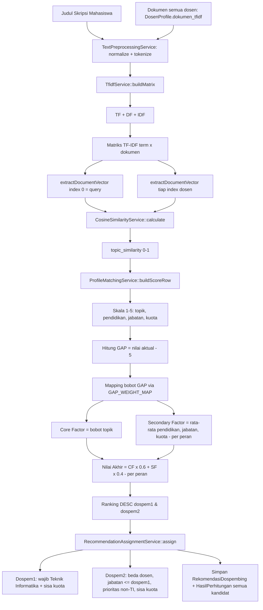

# ALGORITHM — Penjelasan Lengkap Algoritma Rekomendasi

Dokumen ini menjelaskan alur perhitungan rekomendasi dari input (judul skripsi mahasiswa) sampai output (2 dosen pembimbing). Semua berbasis kode nyata — bisa dibuka langsung file-nya saat presentasi sidang.

**Orkestrator utama:** `app/Services/RecommendationGeneratorService.php` (komentar blok di file itu menyebut pipeline **13 tahap**). Di bawah ini dipecah menjadi tahapan yang lebih detail + rumus sebenarnya.

---

## Gambaran Umum

```
judul skripsi mahasiswa (PengajuanJudul.judul_skripsi)
   ↓  (A) preprocessing teks + TF-IDF + Cosine Similarity   → DocumentSimilarityService
   ↓  (B) konversi similarity → skala 1–5                    → ProfileMatchingService
   ↓  (C) Profile Matching: GAP → bobot GAP → CF (60%) + SF (40%)
   ↓  (D) ranking DESC per peran dospem1 & dospem2
   ↓  (E) seleksi & assignment Dospem1 / Dospem2             → RecommendationAssignmentService
   ↓  (F) simpan RekomendasiDospembing + HasilPerhitungan
```

---

## Bagian A — TF-IDF & Cosine Similarity (skor topik)

Diproses oleh `DocumentSimilarityService::compareOneToMany(query, targets)`, yang memakai `TfidfService` (membangun matriks) dan `CosineSimilarityService` (menghitung kemiripan).

> **Konsep kunci:** `compareOneToMany` menggabungkan judul mahasiswa (posisi index 0) dengan semua dokumen dosen dalam **satu korpus bersama**, sehingga nilai IDF konsisten antar semua dosen.

### A.1 — Preprocessing teks

**File:** `app/Services/TextPreprocessingService.php`

| Method | Fungsi |
|---|---|
| `normalize($text)` | case folding ke huruf kecil + hapus semua karakter non-alfanumerik |
| `tokenize($text)` | panggil `normalize()` lalu pecah jadi kata-kata (`preg_split`), dan buang stopword dari daftar `STOPWORDS` (kata Indonesia/Inggris umum seperti "yang", "dan", "untuk") |

Dipakai di `TfidfService::buildMatrix()`: setiap dokumen (judul & dokumen dosen) ditokenisasi dulu.

### A.2 — Term Frequency (TF)

**File/Method:** `TfidfService::termFrequency()`

- Menghitung berapa kali tiap term muncul, lalu **dinormalisasi** dengan total kata di dokumen:
  `tf(t, d) = jumlah_kemunculan(t, d) / total_kata(d)`

### A.3 — Document Frequency (DF)

- Dihitung di dalam `TfidfService::buildMatrix()`: untuk tiap term, hitung **berapa banyak dokumen** yang mengandung term itu (`array_unique` per dokumen, lalu akumulasi).

### A.4 — Inverse Document Frequency (IDF)

- Rumus di `TfidfService::buildMatrix()`:
  `idf(t) = log((N + 1) / (df(t) + 1)) + 1`
  dengan `N` = jumlah dokumen dalam korpus, `df(t)` = document frequency term.

### A.5 — Matriks TF-IDF

- Bobot tiap sel: `w(t, d) = tf(t, d) × idf(t)`.
- Matriks berbentuk `[term => [indexDokumen => bobot]]`.
- **Tidak ada parameter `max_features`** — semua term yang lolos stopword ikut dihitung.

### A.6 — Vektor dokumen

- `TfidfService::extractDocumentVector(matrix, index)` mengambil kolom satu dokumen: `[term => bobot]`.
- Vektor query = index 0, vektor dosen ke-i = index `i+1`.

### A.7 — Cosine Similarity

**File:** `app/Services/CosineSimilarityService.php`

```text
cos(θ) = Σ(ai × bi) / (√Σ(ai²) × √Σ(bi²))
```

- `a` = vektor query, `b` = vektor dosen.
- Jika salah satu vektor kosong (magnitudo 0) → hasil `0.0`.
- **Output:** `topic_similarity` (0.0 – 1.0) per pasangan mahasiswa–dosen.

---

## Bagian B & C — Profile Matching (skor akhir)

**File:** `app/Services/ProfileMatchingService.php`

Service ini murni kalkulator (pure): hanya menerima data yang sudah di-load, tidak query database. Method utamanya `buildScoreRow(PengajuanJudul $pengajuan, Dosen $dosen, float $topicSimilarity, ?KuotaDosenGelombang $kuotaGelombang)`.

### C.1 — Konversi atribut → skala 1–5

| Aspek | Konversi (kode) |
|---|---|
| Topik (dari cosine) | `similarityToScale()`: ≥ 0.50 → 5, ≥ 0.30 → 4, ≥ 0.10 → 3, ≥ 0.05 → 2, lainnya → 1 |
| Pendidikan terakhir | `pendidikanToScale()`: S3 → 5, S2 → 3, lainnya → 1 |
| Jabatan fungsional | `jabatanToScale()`: lektor → 5, asisten ahli → 3, tenaga pengajar → 1, lainnya → 1 |
| Kuota | `quotaToScale()`: persentase sisa kuota (`sisa/total × 100`) → ≥80% → 5, ≥60% → 4, ≥40% → 3, ≥20% → 2, lainnya → 1 |

**Kuota dihitung terpisah untuk peran Dospem1 dan Dospem2** (karena sisa kuota keduanya beda), sehingga skala kuota (`quota_scale_dospem1` / `quota_scale_dospem2`), Secondary Factor, dan nilai akhir juga beda per peran.

> Sumber kuota: prioritas `KuotaDosenGelombang` (per gelombang); jika tidak ada, fallback ke kuota lifetime `Dosen.kuota_dospem1/2 - kuota_terpakai_dospem1/2`.

### C.2 — GAP

- `gap = nilai_aktual - nilai_ideal`, dengan **nilai ideal = 5** (`IDEAL_PROFILE`).
- Karena skala 1–5, GAP selalu ≤ 0 untuk nilai aktual di bawah 5.

### C.3 — Bobot GAP

- `gapToWeight()` memakai tabel `GAP_WEIGHT_MAP` (standar Kusrini, 2007):

| GAP | 0 | +1 | -1 | +2 | -2 | +3 | -3 | +4 | -4 |
|---|---|---|---|---|---|---|---|---|---|
| Bobot | 5.0 | 4.5 | 4.0 | 3.5 | 3.0 | 2.5 | 2.0 | 1.5 | 1.0 |

- GAP di luar tabel → default `0.5`. Semakin dekat nilai aktual ke ideal (GAP 0), semakin tinggi bobotnya.

### C.4 — Core Factor & Secondary Factor

```text
Core Factor (CF)      = bobot_gap_topik                    → 1 aspek (topik)
Secondary Factor (SF) = rata-rata(bobot_gap_pendidikan,
                                  bobot_gap_jabatan,
                                  bobot_gap_kuota)          → 3 aspek, dihitung per peran
```

### C.5 — Nilai Akhir (bobot)

```text
final_score_dospem1 = (CF × 0.6) + (SF_dospem1 × 0.4)
final_score_dospem2 = (CF × 0.6) + (SF_dospem2 × 0.4)
```

- Bobot hardcode: `CORE_FACTOR_WEIGHT = 0.6`, `SECONDARY_FACTOR_WEIGHT = 0.4`.
- **Ini nilai akhirnya** — tidak ada penjumlahan terpisah "skor TF-IDF + skor PM". Skor topik (cosine) sudah **masuk ke dalam** Profile Matching sebagai Core Factor. Nilai berkisar dalam skala bobot (0.5 – 5).

---

## Bagian D — Ranking

**File/Method:** `RecommendationGeneratorService::buildRankedCandidates()`

- Untuk setiap pengajuan: hitung `buildScoreRow()` untuk **semua dosen**, lalu urutkan:
  - `rankedDospem1 = scores->sortByDesc('final_score_dospem1')`
  - `rankedDospem2 = scores->sortByDesc('final_score_dospem2')`

---

## Bagian E — Seleksi & Assignment Dospem1 / Dospem2

**File:** `app/Services/RecommendationAssignmentService.php`

State kuota **sementara (in-memory)** dibuat sekali per batch (`initializeQuotaState()`), lalu dikurangi terus selama batch berjalan (`assign()` dipanggil by-reference). Kolom `kuota_terpakai_*` di database **belum disentuh** pada tahap ini.

### E.1 — Aturan Dospem1 (`pickDospem1()`)

1. **Wajib dari Program Studi "Teknik Informatika"** — pengecekan di `ProfileMatchingService::isEligibleForDospem1()`: membandingkan string `program_studi` (lowercase, trim) dengan `'teknik informatika'`.
2. Sisa kuota Dospem1 di gelombang ini masih ada (`remainingDospem1 > 0`).
3. Kandidat pertama yang memenuhi syarat pada daftar ranking DESC = nilai akhir tertinggi.

### E.2 — Aturan Dospem2 (`pickDospem2()`)

1. Harus **berbeda dosen** dari Dospem1.
2. Sisa kuota Dospem2 masih ada.
3. **Jabatan Dospem1 ≥ Dospem2** — di cek lewat `jabatan_rank`: Lektor(3) > Asisten Ahli(2) > Tenaga Pengajar(1).
4. **Prioritas dosen NON Teknik Informatika** (pass 1). Jika semua dosen non-TI sudah habis kuota, baru **fallback ke dosen TI** (pass 2).
5. Di antara kandidat yang memenuhi syarat, ambil nilai akhir tertinggi (ranking DESC).
6. Jika Dospem1 tidak terisi (`null`), Dospem2 juga tidak diisi (tidak ada acuan jabatan).

### E.3 — Hasil per pengajuan

- `rekomendasi_dospem1_id` + `rekomendasi_dospem2_id` + `skor_dospem1/2` disimpan ke `RekomendasiDospembing`.
- `ringkasan` JSON diisi `judul` + `mahasiswa`.

---

## Bagian F — Penyimpanan Detail Perhitungan (Audit)

**File/Method:** `RecommendationGeneratorService::generateForBatch()` + `buildHasilPerhitunganRows()`

- Untuk **semua kandidat** (bukan hanya yang terpilih), dibuat baris `hasil_perhitungans`:
  - `jenis_dospem` = `dospem1` / `dospem2`
  - `topic_similarity`, `topic_scale`, `quota_scale`, `jabatan_scale`, `pendidikan_scale`
  - `cf_score`, `sf_score`, `final_score`
  - `ranking` = urutan (1 = terbaik)
  - `detail` = snapshot JSON seluruh baris skor
- Semua baris disimpan sekaligus dengan `bulkInsertHasilPerhitungan()` (chunk 500) untuk menghindari N+1.
- Seluruh proses dibungkus `DB::transaction()` oleh `RecommendationService::generateBatch()`, dan membuat satu `RiwayatRekomendasi` berstatus `draft`.

---

## Ringkasan Rumus

| Tahap | Konsep | Rumus / Sumber |
|---|---|---|
| A.2 | TF | `jumlah_kemunculan / total_kata` |
| A.4 | IDF | `log((N+1)/(df+1)) + 1` |
| A.5 | TF-IDF | `tf × idf` |
| A.7 | Cosine | `Σ(ai·bi) / (√Σ(ai²)·√Σ(bi²))` |
| C.1 | Skala 1–5 | mapping per aspek (lihat tabel di atas) |
| C.2 | GAP | `nilai_aktual - 5` |
| C.3 | Bobot GAP | tabel `GAP_WEIGHT_MAP` |
| C.5 | Nilai Akhir | `(CF×0.6) + (SF×0.4)` |
| D | Ranking | `sortByDesc(final_score)` per peran |
| E | Assignment | aturan prodi / kuota / jabatan |

---

## Diagram Alur Perhitungan (untuk Satu Pengajuan)



---

## Cara Membaca Detail di Database (Audit)

Untuk satu pengajuan yang sudah di-generate:

1. `rekomendasi_dospembings` → `rekomendasi_dospem1_id`, `rekomendasi_dospem2_id`, `skor_dospem1`, `skor_dospem2`.
2. `hasil_perhitungans` (FK `rekomendasi_dospembing_id`) → per dosen & per peran: `topic_similarity`, `topic_scale`, `quota_scale`, `jabatan_scale`, `pendidikan_scale`, `cf_score`, `sf_score`, `final_score`, `ranking`, `detail` (JSON rincian).
3. `riwayat_rekomendasis` → `generated_by`, `generated_at`, `status`, `keterangan`.

Ini bisa kamu jelaskan di sidang: sistem **menyimpan jejak audit** setiap nilai sehingga bisa dipertanggungjawabkan.
