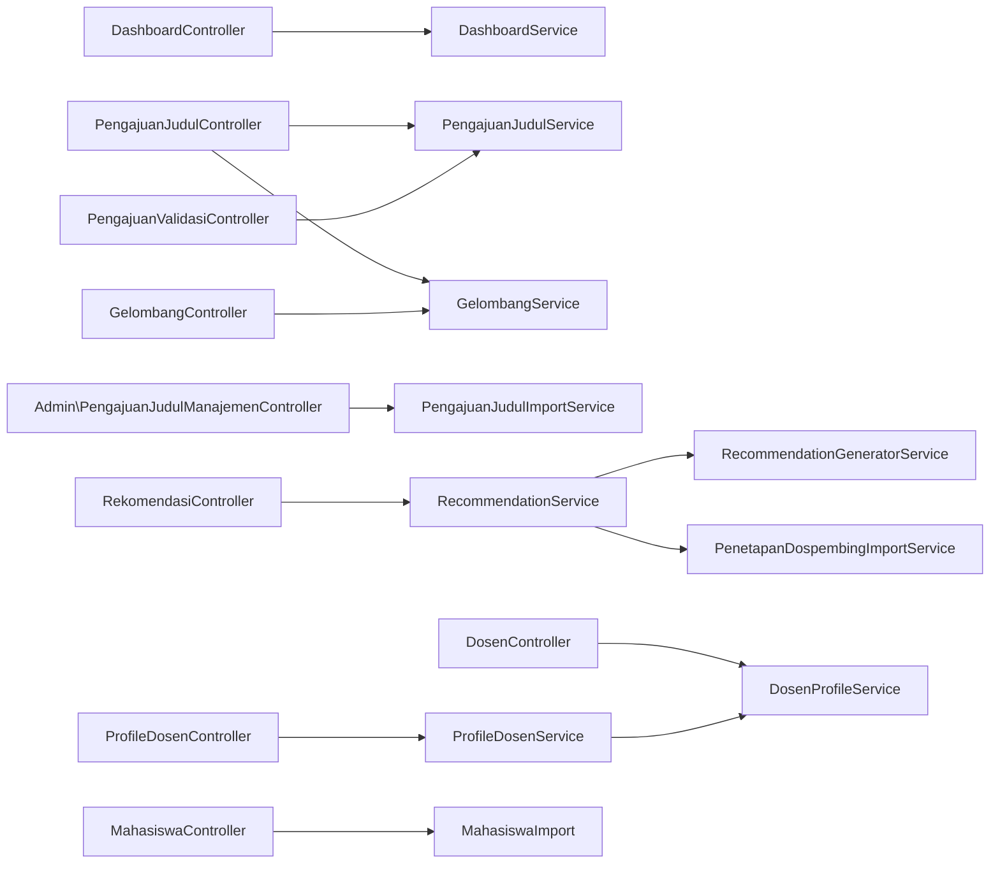

# CONTROLLERS — Penjelasan Semua Controller

Semua Controller berada di `app/Http/Controllers/`. Aturan proyek: Controller **tipis** — menerima request, validasi, memanggil Service, mengembalikan response. Logika bisnis ada di `app/Services/`.

## Daftar Route Lengkap

Semua definisi route ada di `routes/web.php`. Ringkasan per grup:

| Grup                                                                                   | Middleware         | Route utama                                        |
| -------------------------------------------------------------------------------------- | ------------------ | -------------------------------------------------- |
| `/`                                                                                    | `guest`            | redirect ke halaman login                          |
| `/dashboard`                                                                           | `auth, verified`   | Dashboard sesuai role                              |
| `/profile`                                                                             | `auth`             | Edit profil (Breeze)                               |
| `/pengajuan`                                                                           | `auth`             | CRUD pengajuan mahasiswa                           |
| `/admin/pengajuan-judul`                                                               | `auth, role:admin` | Manajemen pengajuan (index/import/export/template) |
| `/admin/validasi-pengajuan`                                                            | `auth, role:admin` | Validasi (approve/reject/approve-all)              |
| `/rekomendasi`                                                                         | `auth, role:admin` | Generate, review, finalisasi, import/export        |
| `/roles`, `/users`, `/prodi`, `/bidang-keahlian`, `/dosen`, `/mahasiswa`, `/gelombang` | `auth, role:admin` | CRUD master data                                   |
| `/profile-saya`                                                                        | `auth, role:dosen` | Edit profil dosen sendiri                          |

---

## 1. DashboardController

**File:** `app/Http/Controllers/DashboardController.php`

- **Fungsi:** Menyajikan dashboard sesuai role user yang login.
- **Service:** `DashboardService`.

| Method    | Endpoint         | Data diterima | Data dikembalikan                                                                          |
| --------- | ---------------- | ------------- | ------------------------------------------------------------------------------------------ |
| `index()` | `GET /dashboard` | user login    | View `dashboard` dengan data dari `DashboardService::forAdmin()/forDosen()/forMahasiswa()` |

**Alur:** `Auth::user()` → jika `isAdmin()` → `forAdmin()`; jika `isDosen()` → `forDosen($user)`; jika `isMahasiswa()` → `forMahasiswa($user)`; selainnya `abort(403)`.

---

## 2. PengajuanJudulController

**File:** `app/Http/Controllers/PengajuanJudulController.php`

- **Fungsi:** CRUD pengajuan judul dari sisi mahasiswa (route resource `pengajuan`). Approve/reject **tidak** ada di sini.
- **Service:** `PengajuanJudulService`, `GelombangService`, `PengajuanJudulImportService`.

| Method      | Endpoint                           | Service                                | Data diterima                               | Data dikembalikan                                          |
| ----------- | ---------------------------------- | -------------------------------------- | ------------------------------------------- | ---------------------------------------------------------- |
| `index()`   | `GET /pengajuan`                   | —                                      | —                                           | View `pengajuan.index` (riwayat pengajuan milik mahasiswa) |
| `create()`  | `GET /pengajuan/create`            | `GelombangService::getOpenGelombang()` | —                                           | View `pengajuan.create`                                    |
| `store()`   | `POST /pengajuan`                  | `PengajuanJudulService::create()`      | `judul_skripsi`, `file_proposal` (PDF ≤2MB) | Redirect ke `pengajuan.index`                              |
| `show()`    | `GET /pengajuan/{pengajuan}`       | —                                      | —                                           | View `pengajuan.show`                                      |
| `edit()`    | `GET /pengajuan/{pengajuan}/edit`  | —                                      | —                                           | View `pengajuan.edit`                                      |
| `update()`  | `PUT/PATCH /pengajuan/{pengajuan}` | `PengajuanJudulService::update()`      | `judul_skripsi`, `file_proposal` (opsional) | Redirect                                                   |
| `destroy()` | `DELETE /pengajuan/{pengajuan}`    | `PengajuanJudulService::delete()`      | —                                           | Redirect                                                   |

**Penjaga akses (private):**

- `ensureMahasiswa()` / `currentMahasiswa()` — hanya role `mahasiswa`, `abort_unless` 403.
- `ensureCanView()` / `ensureCanManage()` — admin/dosen boleh; mahasiswa hanya pengajuan miliknya.
- `ensurePending()` — hanya pengajuan `pending` yang bisa diedit/dihapus.
- `store()` juga mengecek `bolehMengajukanBaru()` dan gelombang terbuka sebelum menyimpan.

---

## 3. PengajuanValidasiController

**File:** `app/Http/Controllers/PengajuanValidasiController.php`

- **Fungsi:** Validasi pengajuan judul oleh admin (approve/reject, termasuk approve semua).
- **Service:** `PengajuanJudulService`.

| Method         | Endpoint                                             | Service                               | Data diterima              | Data dikembalikan                     |
| -------------- | ---------------------------------------------------- | ------------------------------------- | -------------------------- | ------------------------------------- |
| `index()`      | `GET /admin/validasi-pengajuan`                      | —                                     | query: `search`, `status`  | View `admin.validasi-pengajuan.index` |
| `approve()`    | `POST /admin/validasi-pengajuan/{pengajuan}/approve` | `PengajuanJudulService::approve()`    | —                          | Redirect + flash                      |
| `approveAll()` | `POST /admin/validasi-pengajuan/approve-all`         | `PengajuanJudulService::approveAll()` | —                          | Redirect + flash (jumlah)             |
| `reject()`     | `POST /admin/validasi-pengajuan/{pengajuan}/reject`  | `PengajuanJudulService::reject()`     | `alasan_penolakan` (wajib) | Redirect + flash                      |

**Catatan:** `index()` menerima param query `id` untuk menandai pengajuan yang dipilih pada panel detail.

---

## 4. Admin\PengajuanJudulManajemenController

**File:** `app/Http/Controllers/Admin/PengajuanJudulManajemenController.php`

- **Fungsi:** Manajemen pengajuan dari sisi admin (tabel, filter, import/export Excel, unduh template).
- **Service:** `PengajuanJudulImportService`.

| Method               | Endpoint                              | Service                                 | Data diterima                                      | Data dikembalikan                                               |
| -------------------- | ------------------------------------- | --------------------------------------- | -------------------------------------------------- | --------------------------------------------------------------- |
| `index()`            | `GET /admin/pengajuan-judul`          | —                                       | query: `search`, `angkatan`, `status`, `gelombang` | View `admin.pengajuan-judul.index`                              |
| `downloadTemplate()` | `GET /admin/pengajuan-judul/template` | —                                       | —                                                  | File Excel template                                             |
| `export()`           | `GET /admin/pengajuan-judul/export`   | —                                       | query filter                                       | File Excel                                                      |
| `import()`           | `POST /admin/pengajuan-judul/import`  | `PengajuanJudulImportService::import()` | file Excel                                         | Redirect + ringkasan import (`import_summary`, `import_errors`) |

---

## 5. RekomendasiController

**File:** `app/Http/Controllers/RekomendasiController.php`

**Ini controller inti** untuk generate, review, edit draft, finalisasi, dan export rekomendasi.

- **Service:** `RecommendationService`.
- **Penjaga akses:** `authorizeAccess()` → `abort_unless($user->isAdmin() || $user->isDosen(), 403)`. (Pada praktiknya route dibatasi `role:admin`, sehingga dosen tidak bisa menjangkau.)

| Method              | Endpoint                                         | Service                                        | Data diterima                                                 | Data dikembalikan                                                       |
| ------------------- | ------------------------------------------------ | ---------------------------------------------- | ------------------------------------------------------------- | ----------------------------------------------------------------------- |
| `index()`           | `GET /rekomendasi`                               | —                                              | —                                                             | View `rekomendasi.index` (riwayat terbaru + daftar pengajuan disetujui) |
| `generate()`        | `POST /rekomendasi/generate`                     | `RecommendationService::generateBatch()`       | —                                                             | Redirect + flash                                                        |
| `exportExcel()`     | `GET /rekomendasi/export`                        | `RecommendationService::exportLatestToExcel()` | —                                                             | File Excel                                                              |
| `importExcel()`     | `POST /rekomendasi/import`                       | `RecommendationService::finalizeFromImport()`  | file Excel (`xlsx,xls,csv`)                                   | Redirect + flash                                                        |
| `review()`          | `GET /rekomendasi/{riwayat}/review`              | —                                              | `int $riwayatId`                                              | View `admin.rekomendasi.review`                                         |
| `updateDraft()`     | `PATCH /rekomendasi/{rekomendasi}/update-draft`  | —                                              | `rekomendasi_dospem1_id`, `rekomendasi_dospem2_id`, `catatan` | Redirect + flash                                                        |
| `bulkUpdateDraft()` | `PATCH /rekomendasi/{riwayat}/bulk-update-draft` | —                                              | `rows[]` (array per rekomendasi)                              | Redirect + flash                                                        |
| `finalize()`        | `POST /rekomendasi/{riwayat}/finalize`           | `RecommendationService::finalizeDraft()`       | `int $riwayatId`                                              | Redirect + flash                                                        |
| `exportDraft()`     | `GET /rekomendasi/{riwayat}/export-draft`        | `RecommendationService::exportRiwayat()`       | `int $riwayatId`                                              | File Excel                                                              |

**Detail alur tiap method:**

### generate()

1. Ambil gelombang aktif (`Gelombang::where('is_active', true)->first()`); jika tidak ada → flash error.
2. Ambil seluruh `PengajuanJudul` berstatus `disetujui` pada gelombang tersebut.
3. Jika kosong → flash error.
4. `recommendationService->generateBatch($pengajuans)`.
5. Redirect kembali + flash sukses.

### review()

1. `findOrFail($riwayatId)` + eager load rekomendasi → pengajuan → mahasiswa, dospem1/2, `hasilPerhitungans.dosen`, `penetapanDospembing`.
2. Ambil gelombang dari rekomendasi pertama → load semua dosen + `kuotaGelombangs` untuk gelombang itu.
3. Hitung `sisa_kuota_dospem1/2` per dosen (`kuotaForGelombang()->remainingDospem1/2()`).
4. Siapkan `$dosensJson` untuk dropdown JS.
5. Render `admin.rekomendasi.review`.

### updateDraft() / bulkUpdateDraft()

- Memanggil `applyDraftOverride()` per rekomendasi.
- `applyDraftOverride()` (private): mencatat pilihan asli sistem (`ringkasan.original_*`), menulis pilihan baru, dan jika terjadi override menandai `ringkasan.manual_override`, `manual_override_by`, `manual_override_at`, `catatan`. **Hanya mengubah `rekomendasi_dospembings` — kuota tidak diubah.**
- `bulkUpdateDraft()` menolak jika riwayat sudah `finalized`.

### finalize()

- `recommendationService->finalizeDraft($riwayat)` → sinkron ke `penetapan_dospembings` + update kuota (via `PenetapanDospembingImportService`).

### importExcel()

- Validasi file, panggil `finalizeFromImport()`, tangkap `ValidationException` (tampilkan per-bariss error) dan `\Exception`.

---

## 6. GelombangController

**File:** `app/Http/Controllers/GelombangController.php`

- **Fungsi:** CRUD gelombang + toggle status aktif.
- **Service:** `GelombangService`.

| Method           | Endpoint                                     | Service                          |
| ---------------- | -------------------------------------------- | -------------------------------- |
| `index()`        | `GET /gelombang`                             | —                                |
| `create()`       | `GET /gelombang/create`                      | —                                |
| `store()`        | `POST /gelombang`                            | `create($validated)`             |
| `edit()`         | `GET /gelombang/{gelombang}/edit`            | —                                |
| `update()`       | `PUT/PATCH /gelombang/{gelombang}`           | `update($gelombang, $validated)` |
| `destroy()`      | `DELETE /gelombang/{gelombang}`              | `delete($gelombang)`             |
| `toggleStatus()` | `PATCH /gelombang/{gelombang}/toggle-status` | `toggleStatus($gelombang)`       |

Form Request: `StoreGelombangRequest` / `UpdateGelombangRequest`.

---

## 7. DosenController

**File:** `app/Http/Controllers/DosenController.php`

- **Fungsi:** CRUD dosen + import/export Excel + generate ulang `dokumen_tfidf`.
- **Service:** `DosenProfileService`.

| Method                 | Endpoint                 | Service              | Catatan                                                                                         |
| ---------------------- | ------------------------ | -------------------- | ----------------------------------------------------------------------------------------------- |
| `index()`              | `GET /dosen`             | —                    | Filter: `search`, `program_studi_id`, `jabatan_fungsional`, `bidang_keahlian_id`                |
| `create()` / `store()` | `GET/POST /dosen/create` | `syncDokumenTfidf()` | Store juga membuat User (email = NIDN@stmik-mi.ac.id, password = NIDN) + role `dosen` + profile |
| `edit()` / `update()`  | `GET/PUT /dosen/{dosen}` | `syncDokumenTfidf()` | Sinkron nama & email user juga                                                                  |
| `destroy()`            | `DELETE /dosen/{dosen}`  | —                    | Detach bidang keahlian + delete dosen + delete user                                             |
| `export()`             | `GET /dosen/export`      | —                    | Excel                                                                                           |
| `downloadTemplate()`   | `GET /dosen/template`    | —                    | Excel template                                                                                  |
| `import()`             | `POST /dosen/import`     | —                    | `DosenImport`                                                                                   |

**Catatan penting:** setiap store/update memanggil `syncDokumenTfidf($dosen)` sehingga `dosen_profiles.dokumen_tfidf` selalu fresh.

---

## 8. MahasiswaController

**File:** `app/Http/Controllers/MahasiswaController.php`

- **Fungsi:** CRUD mahasiswa + import/export + endpoint DataTables.
- **Service:** tidak ada (langsung Model) untuk CRUD; import via `MahasiswaImport`.

| Method                 | Endpoint                         | Catatan                                                                   |
| ---------------------- | -------------------------------- | ------------------------------------------------------------------------- |
| `index()`              | `GET /mahasiswa`                 | Filter: `search`, `program_studi_id`, `angkatan`                          |
| `create()` / `store()` | `GET/POST /mahasiswa/create`     | Membuat User (password = NIM) + role `mahasiswa`                          |
| `edit()` / `update()`  | `GET/PUT /mahasiswa/{mahasiswa}` | Sinkron user juga                                                         |
| `destroy()`            | `DELETE /mahasiswa/{mahasiswa}`  | Delete user (jika ada) atau mahasiswa                                     |
| `import()`             | `POST /mahasiswa/import`         | `MahasiswaImport`                                                         |
| `export()`             | `GET /mahasiswa/export`          | `MahasiswaExport`                                                         |
| `downloadTemplate()`   | `GET /mahasiswa/template`        | `MahasiswaTemplateExport`                                                 |
| `mahasiswaData()`      | `GET /mahasiswa/data`            | JSON untuk DataTables (`draw`, `recordsTotal`, `recordsFiltered`, `data`) |

---

## 9. ProfileDosenController

**File:** `app/Http/Controllers/ProfileDosenController.php`

- **Fungsi:** Edit profil dosen yang login (role `dosen`).
- **Service:** `ProfileDosenService`.

| Method     | Endpoint            | Service                      |
| ---------- | ------------------- | ---------------------------- |
| `edit()`   | `GET /profile-saya` | —                            |
| `update()` | `PUT /profile-saya` | `update($dosen, $validated)` |

**Catatan:** data diambil dari `Auth::user()->dosen` — tidak ada parameter id di URL, sehingga dosen tidak bisa membuka data dosen lain lewat manipulasi URL.

---

## 10. BidangKeahlianController

**File:** `app/Http/Controllers/BidangKeahlianController.php`

- **Fungsi:** CRUD `bidang_keahlians` (admin).
- **Endpoint:** resource `bidang-keahlian`.
- **Service:** tidak ada (langsung Model). Field: `nama` (unique).

---

## 11. ProdiController

**File:** `app/Http/Controllers/ProdiController.php`

- **Fungsi:** CRUD `program_studis` (admin).
- **Endpoint:** resource `prodi`.
- **Service:** tidak ada (langsung Model). Field: `program_studi`, `kode_prodi`, `jenjang` (D3/S1/S2/S3), `kaprodi`.

---

## 12. UserController

**File:** `app/Http/Controllers/UserController.php`

- **Fungsi:** Kelola akun user & role-nya (admin).
- **Endpoint:** resource `users` (`index`, `edit`, `update`).
- **Service:** tidak ada. `update()` memakai `$user->syncRoles(...)` dari Spatie.

---

## 13. RoleController

**File:** `app/Http/Controllers/RoleController.php`

- **Fungsi:** CRUD role + sync permissions (admin).
- **Endpoint:** resource `roles`.
- **Service:** tidak ada. Memakai `Spatie\Permission\Models\Role` & `Permission`.

---

## 14. KeahlianDosenController — ⚠️ KODE MATI (JANGAN DIPAKAI)

**File:** `app/Http/Controllers/KeahlianDosenController.php`

- **Status:** **Tidak terpakai / dead code.**
- **Alasan:**
    - Tidak ada route untuk controller ini di `routes/web.php`.
    - Tidak ada migrasi/tabel `keahlian_dosens`.
    - `Dosen` tidak memiliki relasi `keahlian()` — method `store()` memanggil `$dosen->keahlian()->create(...)` yang pasti error jika dijalankan.
- **Jangan membangun fitur di atas model `KeahlianDosen`.**

---

## 15. ProfileController (Breeze)

**File:** `app/Http/Controllers/ProfileController.php`

- **Fungsi:** Edit profil akun umum (Breeze): `edit`, `update`, `destroy`.
- **Endpoint:** `/profile` (auth).

---

## 16. Controller Auth (Breeze)

`app/Http/Controllers/Auth/*` — autentikasi standar Breeze (login, register, forgot password, email verification, password confirmation, dll). Route didefinisikan di `routes/auth.php`.

---

## Peta Controller → Service

