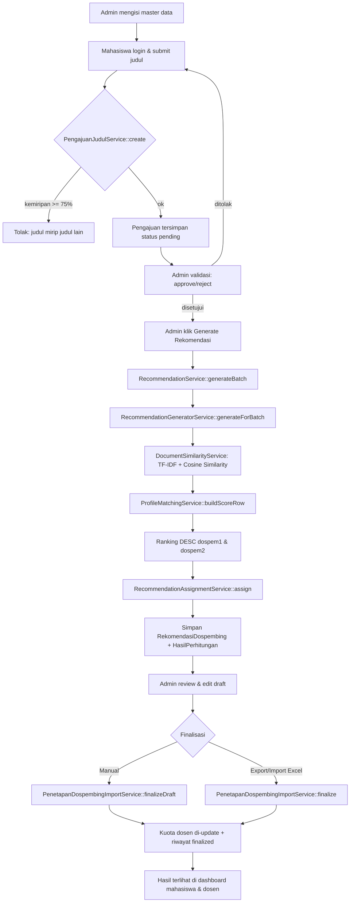
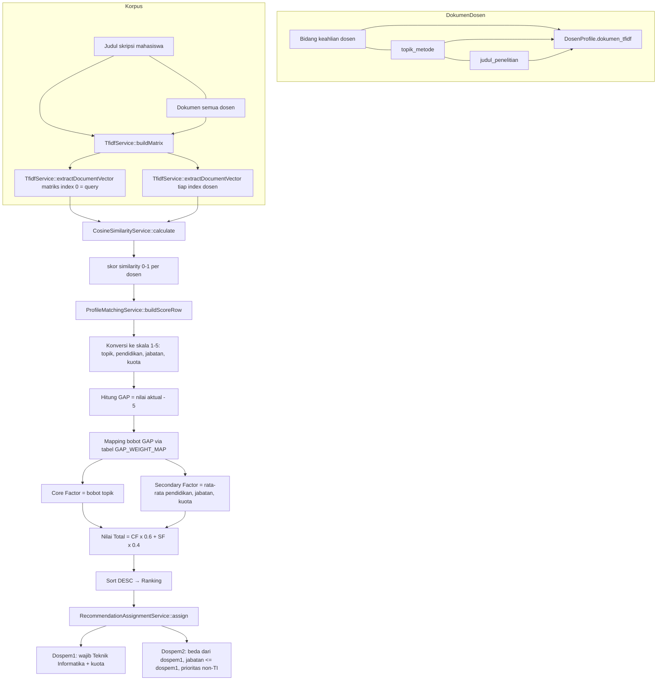
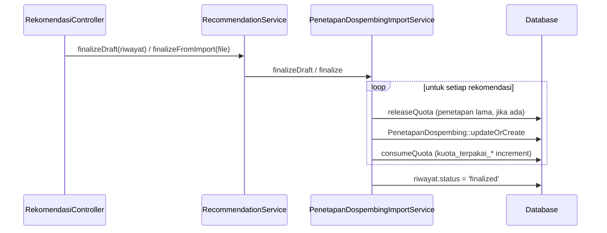

# FLOW — Alur Lengkap Request sampai Hasil Rekomendasi

Dokumen ini menjelaskan alur sistem dari sudut pandang **siapa melakukan apa**, disertai Controller, Service, dan file yang terlibat pada setiap langkah. Versi Mermaid ada di bagian bawah.

---

## Tahap 0 — Persiapan Master Data (Admin)

Sebelum rekomendasi bisa dijalankan, admin harus mengisi data dasar:

| Langkah | Controller | Service | Tabel |
|---|---|---|---|
| Kelola Program Studi | `ProdiController` | — (langsung Model) | `program_studis` |
| Kelola Bidang Keahlian | `BidangKeahlianController` | — (langsung Model) | `bidang_keahlians` |
| Kelola Dosen (+ profil penelitian) | `DosenController` | `DosenProfileService::syncDokumenTfidf()` | `dosens`, `dosen_profiles`, `dosen_bidang_keahlian` |
| Kelola Mahasiswa | `MahasiswaController` | — | `mahasiswas` |
| Kelola Gelombang | `GelombangController` | `GelombangService` | `gelombangs` |
| Atur Kuota per Gelombang | — (dibuat via seeder/DB) | — | `kuota_dosen_gelombangs` |

**Poin penting pada tahap ini:**

- Saat dosen dibuat/diupdate, `DosenController` memanggil `DosenProfileService::syncDokumenTfidf($dosen)`, yang menggabungkan **bidang keahlian + topik_metode + judul_penelitian** menjadi satu string disimpan di `dosen_profiles.dokumen_tfidf`. String ini yang nanti menjadi "dokumen" dosen saat perhitungan cosine similarity.
- `GelombangService` memastikan **hanya satu gelombang yang aktif** dalam satu waktu.

---

## Tahap 1 — Mahasiswa Mengajukan Judul Skripsi

**Route:** `POST /pengajuan` (`pengajuan.store`)  
**Controller:** `PengajuanJudulController::store()`  
**Service:** `PengajuanJudulService::create()`

Alur:

1. Middleware `auth` memastikan user login.
2. `PengajuanJudulController::store()` memeriksa `bolehMengajukanBaru()` (mahasiswa tidak boleh mengajukan baru jika masih punya pengajuan `pending` atau `disetujui`).
3. Controller mengambil gelombang yang sedang terbuka: `GelombangService::getOpenGelombang()` (syarat: `is_active = true` dan hari ini berada di antara `tanggal_mulai`–`tanggal_selesai`).
4. Validasi request: `judul_skripsi` (string max 255) dan `file_proposal` (PDF max 2MB).
5. `PengajuanJudulService::create()`:
   - Mengecek kemiripan judul via `TextSimilarityService::checkSimilarity()`. Jika kemiripan ≥ 75% dengan judul mahasiswa lain yang berstatus `disetujui`, pengajuan **ditolak oleh sistem** (ValidationException).
   - Menyimpan file proposal ke `storage/app/public/proposal/`.
   - Membuat record `pengajuan_juduls` berstatus `pending`.

```
Mahasiswa (form pengajuan)
   → POST /pengajuan
   → PengajuanJudulController::store
   → PengajuanJudulService::create
       ├─ TextSimilarityService::checkSimilarity  (cegah judul duplikat)
       └─ simpan file proposal + insert pengajuan_juduls (status = pending)
```

---

## Tahap 2 — Admin Memvalidasi Pengajuan

**Route:** `POST /admin/validasi-pengajuan/{pengajuan}/approve` dan `.../reject`  
**Controller:** `PengajuanValidasiController::approve()` / `reject()` / `approveAll()`  
**Service:** `PengajuanJudulService::approve()` / `reject()` / `approveAll()`

1. Middleware `role:admin`.
2. Hanya pengajuan berstatus `pending` yang boleh divalidasi.
3. `PengajuanJudulService::approve()` memanggil model `PengajuanJudul::approve($validator)`:
   - `status` → `disetujui`
   - `divalidasi_oleh` → id admin, `validated_at` → sekarang
4. `reject()` membutuhkan `alasan_penolakan` (wajib diisi).

> Hanya pengajuan berstatus `disetujui` yang akan diproses pada tahap generate rekomendasi.

---

## Tahap 3 — Admin Generate Rekomendasi (INTI SISTEM)

**Route:** `POST /rekomendasi/generate`  
**Controller:** `RekomendasiController::generate()`  
**Service:** `RecommendationService::generateBatch()` → `RecommendationGeneratorService::generateForBatch()`

### 3.1 Di Controller

1. Cari gelombang aktif: `Gelombang::where('is_active', true)->first()`.
2. Ambil seluruh pengajuan berstatus `disetujui` pada gelombang tersebut.
3. Jika tidak ada, kembali dengan pesan error.
4. Panggil `recommendationService->generateBatch($pengajuans)`.

### 3.2 Di RecommendationService::generateBatch()

1. `Auth::id()` diambil sebagai `generated_by`.
2. Seluruh proses dibungkus `DB::transaction(...)`.
3. Membuat record `riwayat_rekomendasis` berstatus **`draft`** (satu batch = satu riwayat).
4. Memanggil `RecommendationGeneratorService::generateForBatch($pengajuans, $riwayat)`.

### 3.3 Di RecommendationGeneratorService::generateForBatch()

1. **Preload data:** seluruh dosen beserta `programStudi` dan `profile` (satu query, hindari N+1).
2. Ambil `gelombang_id` dari pengajuan pertama.
3. **Load kuota per gelombang** untuk semua dosen: `loadKuotaGelombangMap()`.
4. **Inisialisasi state kuota sementara** (in-memory): `RecommendationAssignmentService::initializeQuotaState()`.
5. Untuk **setiap pengajuan**, jalankan:
   - `buildRankedCandidates()` — menghitung skor & ranking semua dosen (lihat [ALGORITHM.md](ALGORITHM.md)).
   - `RecommendationAssignmentService::assign()` — memilih dospem1 & dospem2 berdasarkan ranking + aturan kuota.
   - Simpan `rekomendasi_dospembings` (dospem1, dospem2, skor, ringkasan).
   - Bangun baris `hasil_perhitungans` untuk **semua kandidat** (bukan hanya yang terpilih) — dipakai halaman detail perhitungan.
6. Setelah loop, `bulkInsertHasilPerhitungan()` menyimpan seluruh baris ranking sekaligus (chunk 500).

```
POST /rekomendasi/generate
   → RekomendasiController::generate
   → RecommendationService::generateBatch
       ├─ DB::transaction
       ├─ RiwayatRekomendasi::create (status 'draft')
       └─ RecommendationGeneratorService::generateForBatch
           ├─ loadDosenCandidates + loadKuotaGelombangMap
           ├─ RecommendationAssignmentService::initializeQuotaState
           └─ untuk setiap pengajuan:
               ├─ DocumentSimilarityService::compareOneToMany  (TF-IDF + Cosine)
               ├─ ProfileMatchingService::buildScoreRow        (skor 1-5)
               ├─ sort DESC → ranking dospem1 & dospem2
               ├─ RecommendationAssignmentService::assign      (pilih dospem1/2)
               ├─ RekomendasiDospembing::create
               └─ buildHasilPerhitunganRows (semua kandidat)
           └─ bulkInsertHasilPerhitungan
```

**Hasil tahap ini (semua di database):**

- `riwayat_rekomendasis` — 1 baris (status `draft`)
- `rekomendasi_dospembings` — 1 baris per pengajuan (dospem1 & dospem2 terpilih + skor)
- `hasil_perhitungans` — 2 × N baris per pengajuan (ranking semua kandidat untuk peran dospem1 dan dospem2)

> **Catatan:** pada tahap ini kolom `kuota_terpakai_*` di `dosens` dan `kuota_dosen_gelombangs` **belum diubah**. Kuota hanya dijaga lewat state in-memory selama batch berjalan.

---

## Tahap 4 — Admin Meninjau Draft (Opsional, Bisa di-Edit)

**Route:** `GET /rekomendasi/{riwayat}/review`  
**Controller:** `RekomendasiController::review()`

- Menampilkan seluruh rekomendasi draft pada satu riwayat.
- Setiap rekomendasi menampilkan `hasil_perhitungans` (semua kandidat + ranking) untuk halaman detail perhitungan.
- Admin bisa mengganti dosen terpilih via dropdown:
  - `PATCH /rekomendasi/{rekomendasi}/update-draft` → `updateDraft()` (satu baris)
  - `PATCH /rekomendasi/{riwayat}/bulk-update-draft` → `bulkUpdateDraft()` (semua baris sekaligus)
- Perubahan **hanya** mengubah `rekomendasi_dospembings` dan mencatat override di kolom JSON `ringkasan` (misal `manual_override`, `manual_override_by`, `catatan`). Kuota tidak disentuh di tahap ini.
- Riwayat berstatus `finalized` **tidak bisa** diedit lagi.

---

## Tahap 5 — Finalisasi (Dua Jalur)

Hasil draft bisa difinalisasi melalui **dua jalur**. Keduanya menghasilkan record di `penetapan_dospembings` dan **baru saat inilah** kuota dosen di-update ke database.

### Jalur A — Finalisasi Manual (tanpa Excel)

**Route:** `POST /rekomendasi/{riwayat}/finalize`  
**Controller:** `RekomendasiController::finalize()`  
**Service:** `RecommendationService::finalizeDraft()` → `PenetapanDospembingImportService::finalizeDraft()`

1. Pastikan riwayat belum `finalized` dan punya rekomendasi draft.
2. Dalam transaksi, untuk setiap `RekomendasiDospembing`:
   - `releaseQuota()` — lepas kuota penetapan lama (jika ada, agar tidak dobel hitung).
   - `PenetapanDospembing::updateOrCreate(['pengajuan_id' => ...])` — sinkronkan dospem1/dospem2 dari draft, `sumber = 'manual'`.
   - `consumeQuota()` — `kuota_terpakai_dospem1/2` di `dosens` dan `kuota_dosen_gelombangs` di-increment.
3. Status riwayat diubah menjadi **`finalized`**.

### Jalur B — Finalisasi via Export → Edit → Import Excel

1. **Export:** `GET /rekomendasi/{riwayat}/export-draft` → `RekomendasiController::exportDraft()` → `ExcelExportService::export()` → `RekomendasiDospemExport`. File berisi kolom wajib: `riwayat_rekomendasi_id`, `rekomendasi_dospembing_id`, `final_nidn_dospem_1`, `final_nidn_dospem_2`.
2. Admin boleh mengubah NIDN dosen di Excel (penetapan final).
3. **Import:** `POST /rekomendasi/import` → `RekomendasiController::importExcel()` → `RecommendationService::finalizeFromImport()` → `PenetapanDospembingImport` → `PenetapanDospembingImportService::finalize()`.
   - Validasi: file hanya boleh berisi **satu** `riwayat_rekomendasi_id`; pengajuan & dosen harus ditemukan; dospem1 ≠ dospem2.
   - `releaseQuota()` penetapan lama → `updateOrCreate` penetapan baru (`sumber = 'import'`) → `consumeQuota()`.
   - Status riwayat → `finalized`.

```
Draft (rekomendasi_dospembings, status riwayat 'draft')
   ├─ Jalur A: POST /{riwayat}/finalize  → finalizeDraft()
   └─ Jalur B: export Excel → edit → POST /import → PenetapanDospembingImport::finalize()
                ↓
   PenetapanDospembingImportService
   ├─ releaseQuota (penetapan lama)
   ├─ PenetapanDospembing::updateOrCreate (sumber 'manual' atau 'import')
   ├─ consumeQuota → kuota_terpakai_* di-update (dosens + kuota_dosen_gelombangs)
   └─ riwayat.status = 'finalized'
```

---

## Tahap 6 — Melihat Hasil

| Pengguna | Endpoint | Controller / Service | Menampilkan |
|---|---|---|---|
| Semua role | `GET /dashboard` | `DashboardController::index()` → `DashboardService::forAdmin()/forDosen()/forMahasiswa()` | Dashboard sesuai role |
| Mahasiswa | `GET /dashboard` | `DashboardService::forMahasiswa()` | Status pengajuan + dosen pembimbing yang sudah ditetapkan (dari `penetapan_dospembings`) |
| Dosen | `GET /dashboard` | `DashboardService::forDosen()` | Daftar bimbingan dari `penetapan_dospembings` (hanya riwayat `finalized`), sisa kuota |
| Admin | `GET /dashboard` | `DashboardService::forAdmin()` | Ringkasan statistik |

---

## Diagram Alur (Mermaid)

### Alur utama end-to-end



### Alur perhitungan skor (inti algoritma)



### Alur finalisasi & kuota



---

## Ringkasan Peran Setiap Tahap

| Tahap | Pelaku | Controller | Service | Output DB |
|---|---|---|---|---|
| 1. Submit judul | Mahasiswa | `PengajuanJudulController::store` | `PengajuanJudulService::create` | `pengajuan_juduls` (pending) |
| 2. Validasi | Admin | `PengajuanValidasiController` | `PengajuanJudulService` | `pengajuan_juduls` (disetujui/ditolak) |
| 3. Generate | Admin | `RekomendasiController::generate` | `RecommendationService` → `RecommendationGeneratorService` | `riwayat_rekomendasis`, `rekomendasi_dospembings`, `hasil_perhitungans` |
| 4. Review/edit | Admin | `RekomendasiController::review/updateDraft/bulkUpdateDraft` | — (langsung Model) | `rekomendasi_dospembings.ringkasan` |
| 5. Finalisasi | Admin | `RekomendasiController::finalize/importExcel` | `PenetapanDospembingImportService` | `penetapan_dospembings` + `kuota_terpakai_*` |
| 6. Lihat hasil | Semua | `DashboardController::index` | `DashboardService` | — (read-only) |
