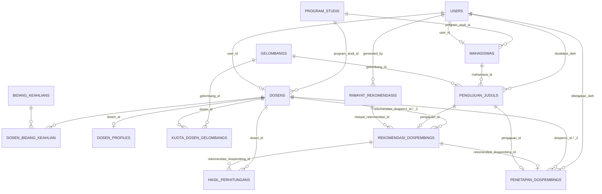

# MODELS — Penjelasan Semua Model Eloquent

Semua model ada di `app/Models/`. Model memetakan tabel database ke objek PHP. Relasi dibaca lewat method relasi (misal `$pengajuan->mahasiswa->nama`).

> **Catatan:** dokumentasi ini disusun dari **kode nyata** (file model + migrasi). Nama kolom di sini adalah yang benar-benar dipakai aplikasi (contoh: `kuota_dospem1`, bukan `kuota_pembimbing_1`).

---

## 1. User

**Tabel:** `users` | **File:** `app/Models/User.php`

Model user inti (dipakai Breeze + Spatie Permission). Satu `User` = satu `Dosen` ATAU satu `Mahasiswa`.

**Member penting:**

| Member               | Tipe  | Penjelasan                                          |
| -------------------- | ----- | --------------------------------------------------- |
| `$fillable`          | array | `name`, `email`, `password`                         |
| `$hidden`            | array | `password`, `remember_token`                        |
| `$casts`             | array | `email_verified_at` → datetime, `password` → hashed |
| `isAdmin()`          | bool  | `hasRole('admin')`                                  |
| `isDosen()`          | bool  | `hasRole('dosen')`                                  |
| `isMahasiswa()`      | bool  | `hasRole('mahasiswa')`                              |
| `hasVerifiedEmail()` | bool  | `email_verified_at` terisi                          |

**Relasi:**

| Method relasi | Tipe     | Target      |
| ------------- | -------- | ----------- |
| `dosen()`     | `HasOne` | `Dosen`     |
| `mahasiswa()` | `HasOne` | `Mahasiswa` |

---

## 2. Dosen

**Tabel:** `dosens` | **File:** `app/Models/Dosen.php`

Data dosen + kuota pembimbing (lifetime). Kuota per-gelombang ada di `KuotaDosenGelombang`.

**Member penting:**

| Member                     | Tipe  | Penjelasan                                                                                                                                                                                |
| -------------------------- | ----- | ----------------------------------------------------------------------------------------------------------------------------------------------------------------------------------------- |
| `$fillable`                | array | `user_id`, `program_studi_id`, `nidn`, `nama`, `pendidikan_terakhir`, `jabatan_fungsional`, `kuota_dospem1`, `kuota_dospem2`, `kuota_terpakai_dospem1`, `kuota_terpakai_dospem2`, `no_hp` |
| `kuota_dospem1`            | int   | kuota lifetime Dospem1 (default 15 di migrasi)                                                                                                                                            |
| `kuota_dospem2`            | int   | kuota lifetime Dospem2 (default 10)                                                                                                                                                       |
| `kuota_terpakai_dospem1/2` | int   | kuota lifetime yang sudah terpakai (hanya di-update saat finalisasi)                                                                                                                      |

**Relasi:**

| Method relasi       | Tipe            | Target                                           |
| ------------------- | --------------- | ------------------------------------------------ |
| `user()`            | `BelongsTo`     | `User`                                           |
| `programStudi()`    | `BelongsTo`     | `ProgramStudi`                                   |
| `bidangKeahlians()` | `BelongsToMany` | `BidangKeahlian` (pivot `dosen_bidang_keahlian`) |
| `profile()`         | `HasOne`        | `DosenProfile`                                   |
| `kuotaGelombangs()` | `HasMany`       | `KuotaDosenGelombang`                            |

**Helper:**

| Method                                | Return                 | Penjelasan                             |
| ------------------------------------- | ---------------------- | -------------------------------------- |
| `kuotaForGelombang(int $gelombangId)` | `?KuotaDosenGelombang` | ambil kuota dosen untuk satu gelombang |

---

## 3. DosenProfile

**Tabel:** `dosen_profiles` | **File:** `app/Models/DosenProfile.php`

Profil penelitian dosen + dokumen teks mentah untuk TF-IDF.

**Member penting:**

| Member             | Tipe     | Penjelasan                                                                                                                  |
| ------------------ | -------- | --------------------------------------------------------------------------------------------------------------------------- |
| `$fillable`        | array    | `dosen_id`, `topik_metode`, `judul_penelitian`, `dokumen_tfidf`                                                             |
| `topik_metode`     | text     | topik & metode penelitian (bisa diisi dosen lewat "Profile Saya")                                                           |
| `judul_penelitian` | longText | judul-judul penelitian dosen                                                                                                |
| `dokumen_tfidf`    | longText | **gabungan teks bidang keahlian + topik_metode + judul_penelitian**, dibentuk `DosenProfileService::generateDokumenTfidf()` |

**Relasi:**

| Method relasi | Tipe        | Target  |
| ------------- | ----------- | ------- |
| `dosen()`     | `BelongsTo` | `Dosen` |

**Penting:** satu dosen = satu baris profile (kolom `dosen_id` unik di migrasi). Tidak ada kolom `is_latest`. Dokumen ini dipakai sebagai "dokumen dosen" saat generate; corpus + IDF dibangun ulang setiap kali generate.

---

## 4. ProgramStudi

**Tabel:** `program_studis` | **File:** `app/Models/ProgramStudi.php`

- **Field:** `program_studi`, `kode_prodi`, `jenjang` (D3/S1/S2/S3), `kaprodi`.
- **Relasi:** `dosens()` `HasMany` → `Dosen`.

---

## 5. BidangKeahlian

**Tabel:** `bidang_keahlians` | **File:** `app/Models/BidangKeahlian.php`

- **Field:** `nama` (unique).
- **Relasi:** `dosens()` `BelongsToMany` → `Dosen` (via pivot `dosen_bidang_keahlian`).

---

## 6. Mahasiswa

**Tabel:** `mahasiswas` | **File:** `app/Models/Mahasiswa.php`

**Member penting:**

| Member      | Tipe  | Penjelasan                                                        |
| ----------- | ----- | ----------------------------------------------------------------- |
| `$fillable` | array | `user_id`, `nim`, `nama`, `program_studi_id`, `angkatan`, `no_hp` |

**Relasi:**

| Method relasi           | Tipe             | Target                                       |
| ----------------------- | ---------------- | -------------------------------------------- |
| `user()`                | `BelongsTo`      | `User`                                       |
| `programStudi()`        | `BelongsTo`      | `ProgramStudi`                               |
| `pengajuanJuduls()`     | `HasMany`        | `PengajuanJudul`                             |
| `penetapanDospembing()` | `HasManyThrough` | `PenetapanDospembing` (via `PengajuanJudul`) |

**Helper (aturan bisnis):**

| Method                          | Return | Penjelasan                                               |
| ------------------------------- | ------ | -------------------------------------------------------- |
| `sudahMengajukan()`             | bool   | punya pengajuan status `pending` atau `disetujui`        |
| `punyaPengajuanDisetujui()`     | bool   | punya pengajuan `disetujui`                              |
| `punyaPengajuanPending()`       | bool   | punya pengajuan `pending`                                |
| `bolehMengajukanBaru()`         | bool   | `!punyaPengajuanPending() && !punyaPengajuanDisetujui()` |
| `sudahMemilikiPenetapanFinal()` | bool   | punya pengajuan yang sudah ada `PenetapanDospembing`     |

---

## 7. PengajuanJudul

**Tabel:** `pengajuan_juduls` | **File:** `app/Models/PengajuanJudul.php`

Proposal judul skripsi mahasiswa — **input utama pipeline rekomendasi**.

**Member penting:**

| Member            | Tipe      | Penjelasan                                                                                                                        |
| ----------------- | --------- | --------------------------------------------------------------------------------------------------------------------------------- |
| `$fillable`       | array     | `mahasiswa_id`, `judul_skripsi`, `file_proposal`, `status`, `alasan_penolakan`, `gelombang_id`, `divalidasi_oleh`, `validated_at` |
| `status`          | enum      | **`pending` / `disetujui` / `ditolak`** (tidak ada `revisi` pada versi ini)                                                       |
| `divalidasi_oleh` | FK        | id admin/kaprodi yang memvalidasi                                                                                                 |
| `validated_at`    | timestamp | waktu validasi                                                                                                                    |

**Relasi:**

| Method relasi             | Tipe        | Target                                       |
| ------------------------- | ----------- | -------------------------------------------- |
| `mahasiswa()`             | `BelongsTo` | `Mahasiswa`                                  |
| `validator()`             | `BelongsTo` | `User` (via `divalidasi_oleh`)               |
| `gelombang()`             | `BelongsTo` | `Gelombang`                                  |
| `rekomendasiDospembing()` | `HasOne`    | `RekomendasiDospembing` (via `pengajuan_id`) |
| `penetapanDospembing()`   | `HasOne`    | `PenetapanDospembing` (via `pengajuan_id`)   |

**Scope:** `pending()`, `disetujui()`, `ditolak()`.

**Helper:**

| Method                                          | Penjelasan                                                                                      |
| ----------------------------------------------- | ----------------------------------------------------------------------------------------------- |
| `approve(User $validator)`                      | ubah status → `disetujui`, isi `divalidasi_oleh` + `validated_at`, kosongkan `alasan_penolakan` |
| `reject(User $validator, string $alasan)`       | ubah status → `ditolak`, isi `alasan_penolakan` + `divalidasi_oleh` + `validated_at`            |
| `isPending()` / `isDisetujui()` / `isDitolak()` | pembanding status                                                                               |
| `getStatusBadgeAttribute()`                     | kelas Tailwind untuk badge status                                                               |

---

## 8. Gelombang

**Tabel:** `gelombangs` | **File:** `app/Models/Gelombang.php`

Periode akademik tempat mahasiswa mengajukan judul.

**Member penting:**

| Member             | Tipe      | Penjelasan                                                                  |
| ------------------ | --------- | --------------------------------------------------------------------------- |
| `$fillable`        | array     | `nama`, `periode_akademik`, `tanggal_mulai`, `tanggal_selesai`, `is_active` |
| `periode_akademik` | string(5) | format `YYYY1` (Ganjil) / `YYYY2` (Genap), unique                           |
| `$casts`           | array     | `tanggal_mulai`, `tanggal_selesai` → date, `is_active` → boolean            |

**Relasi:**

| Method relasi       | Tipe      | Target                |
| ------------------- | --------- | --------------------- |
| `pengajuanJuduls()` | `HasMany` | `PengajuanJudul`      |
| `kuotaDosens()`     | `HasMany` | `KuotaDosenGelombang` |

**Scope & helper:**

| Member                               | Keterangan                             |
| ------------------------------------ | -------------------------------------- |
| `scopeActive()`                      | `is_active = true`                     |
| `scopeCurrentlyOpen()`               | aktif + hari ini dalam rentang tanggal |
| `activeGelombang()`                  | `?self` — gelombang aktif pertama      |
| `isOpenForSubmission()`              | bool — apakah terbuka hari ini         |
| `getPeriodeAkademikLabelAttribute()` | tampilan "2025 Ganjil" / "2026 Genap"  |
| `periodeAkademikOptions()`           | daftar periode untuk dropdown          |

---

## 9. RiwayatRekomendasi

**Tabel:** `riwayat_rekomendasis` | **File:** `app/Models/RiwayatRekomendasi.php`

Satu baris = satu batch hasil generate rekomendasi.

**Member penting:**

| Member         | Tipe      | Penjelasan                                                                                                                         |
| -------------- | --------- | ---------------------------------------------------------------------------------------------------------------------------------- |
| `$fillable`    | array     | `generated_by`, `generated_at`, `status`, `keterangan`                                                                             |
| `generated_by` | FK        | `users.id` — admin yang klik Generate                                                                                              |
| `generated_at` | timestamp | waktu batch dibuat                                                                                                                 |
| `status`       | enum      | `draft` / `exported` / `imported` / `finalized` — **kode hanya menulis `draft` (saat generate) dan `finalized` (saat finalisasi)** |
| `$casts`       | array     | `generated_at` → datetime                                                                                                          |

> **Catatan:** `RiwayatRekomendasi` **tidak punya** `gelombang_id`. Gelombang diambil tidak langsung lewat pengajuan (`rekomendasiDospembings.pengajuan.gelombang_id`).

**Relasi:**

| Method relasi              | Tipe        | Target                      |
| -------------------------- | ----------- | --------------------------- |
| `generatedBy()`            | `BelongsTo` | `User` (via `generated_by`) |
| `rekomendasiDospembings()` | `HasMany`   | `RekomendasiDospembing`     |

---

## 10. RekomendasiDospembing

**Tabel:** `rekomendasi_dospembings` | **File:** `app/Models/RekomendasiDospembing.php`

Hasil rekomendasi **draft** per pengajuan (belum final). Ini yang ditampilkan di halaman review dan bisa di-override manual.

**Member penting:**

| Member           | Tipe         | Penjelasan                                                                                                                                         |
| ---------------- | ------------ | -------------------------------------------------------------------------------------------------------------------------------------------------- |
| `$fillable`      | array        | `riwayat_rekomendasi_id`, `pengajuan_id`, `rekomendasi_dospem1_id`, `rekomendasi_dospem2_id`, `skor_dospem1`, `skor_dospem2`, `ringkasan`          |
| `skor_dospem1/2` | decimal(8,4) | nilai akhir (bobot) dospem terpilih                                                                                                                |
| `ringkasan`      | json         | berisi `judul`, `mahasiswa`; saat override manual bertambah `original_*`, `manual_override`, `manual_override_by`, `manual_override_at`, `catatan` |
| `$casts`         | array        | `skor_dospem1/2` → decimal:4, `ringkasan` → array                                                                                                  |

**Relasi:**

| Method relasi           | Tipe        | Target                                 |
| ----------------------- | ----------- | -------------------------------------- |
| `riwayatRekomendasi()`  | `BelongsTo` | `RiwayatRekomendasi`                   |
| `pengajuan()`           | `BelongsTo` | `PengajuanJudul` (via `pengajuan_id`)  |
| `rekomendasiDospem1()`  | `BelongsTo` | `Dosen` (via `rekomendasi_dospem1_id`) |
| `rekomendasiDospem2()`  | `BelongsTo` | `Dosen` (via `rekomendasi_dospem2_id`) |
| `hasilPerhitungans()`   | `HasMany`   | `HasilPerhitungan`                     |
| `penetapanDospembing()` | `HasOne`    | `PenetapanDospembing`                  |

---

## 11. HasilPerhitungan

**Tabel:** `hasil_perhitungans` | **File:** `app/Models/HasilPerhitungan.php`

Detail skor **seluruh kandidat dosen** untuk satu rekomendasi (bukan hanya yang terpilih) — dipakai halaman detail perhitungan.

**Member penting:**

| Member                                                               | Tipe         | Penjelasan                                                                                                                                                                                                 |
| -------------------------------------------------------------------- | ------------ | ---------------------------------------------------------------------------------------------------------------------------------------------------------------------------------------------------------- |
| `$fillable`                                                          | array        | `rekomendasi_dospembing_id`, `dosen_id`, `jenis_dospem`, `topic_similarity`, `topic_scale`, `quota_scale`, `jabatan_scale`, `pendidikan_scale`, `cf_score`, `sf_score`, `final_score`, `ranking`, `detail` |
| `jenis_dospem`                                                       | enum         | `dospem1` / `dospem2`                                                                                                                                                                                      |
| `topic_similarity`                                                   | decimal(8,4) | skor cosine 0–1                                                                                                                                                                                            |
| `topic_scale` / `quota_scale` / `jabatan_scale` / `pendidikan_scale` | tinyint      | konversi ke skala 1–5                                                                                                                                                                                      |
| `cf_score` / `sf_score` / `final_score`                              | decimal(8,4) | skor Core/Secondary/Akhir                                                                                                                                                                                  |
| `ranking`                                                            | int          | urutan ranking kandidat (1 = tertinggi)                                                                                                                                                                    |
| `detail`                                                             | json         | snapshot seluruh baris skor (tanpa objek Dosen)                                                                                                                                                            |
| `$casts`                                                             | array        | kolom skala → integer, kolom skor → decimal:4, `detail` → array                                                                                                                                            |

**Relasi:**

| Method relasi             | Tipe        | Target                  |
| ------------------------- | ----------- | ----------------------- |
| `rekomendasiDospembing()` | `BelongsTo` | `RekomendasiDospembing` |
| `dosen()`                 | `BelongsTo` | `Dosen`                 |

**Catatan:** unik per `(rekomendasi_dospembing_id, dosen_id, jenis_dospem)`.

---

## 12. KuotaDosenGelombang

**Tabel:** `kuota_dosen_gelombangs` | **File:** `app/Models/KuotaDosenGelombang.php`

Kuota **per dosen per gelombang** — inilah yang dipakai pipeline rekomendasi (bukan kuota lifetime di `dosens`).

**Member penting:**

| Member      | Tipe  | Penjelasan                                                                                                       |
| ----------- | ----- | ---------------------------------------------------------------------------------------------------------------- |
| `$fillable` | array | `dosen_id`, `gelombang_id`, `kuota_dospem1`, `kuota_dospem2`, `kuota_terpakai_dospem1`, `kuota_terpakai_dospem2` |
| `$casts`    | array | keempat kolom kuota → integer                                                                                    |

**Relasi:**

| Method relasi | Tipe        | Target      |
| ------------- | ----------- | ----------- |
| `dosen()`     | `BelongsTo` | `Dosen`     |
| `gelombang()` | `BelongsTo` | `Gelombang` |

**Helper:**

| Method               | Return | Penjelasan                                       |
| -------------------- | ------ | ------------------------------------------------ |
| `remainingDospem1()` | int    | `max(kuota_dospem1 - kuota_terpakai_dospem1, 0)` |
| `remainingDospem2()` | int    | `max(kuota_dospem2 - kuota_terpakai_dospem2, 0)` |

**Catatan:** unik per `(dosen_id, gelombang_id)`. `kuota_terpakai_*` hanya di-update saat **finalisasi** (`PenetapanDospembingImportService::consumeQuota`).

---

## 13. PenetapanDospembing

**Tabel:** `penetapan_dospembings` | **File:** `app/Models/PenetapanDospembing.php`

Hasil **FINAL** pembimbing per pengajuan (hasil finalisasi manual atau import Excel).

**Member penting:**

| Member      | Tipe  | Penjelasan                                                                                                                       |
| ----------- | ----- | -------------------------------------------------------------------------------------------------------------------------------- |
| `$fillable` | array | `rekomendasi_dospembing_id`, `pengajuan_id`, `dospem1_id`, `dospem2_id`, `ditetapkan_oleh`, `ditetapkan_at`, `sumber`, `catatan` |
| `sumber`    | enum  | `import` / `manual`                                                                                                              |
| `$casts`    | array | `ditetapkan_at` → datetime                                                                                                       |

**Relasi:**

| Method relasi             | Tipe        | Target                                |
| ------------------------- | ----------- | ------------------------------------- |
| `rekomendasiDospembing()` | `BelongsTo` | `RekomendasiDospembing`               |
| `pengajuan()`             | `BelongsTo` | `PengajuanJudul` (via `pengajuan_id`) |
| `dospem1()`               | `BelongsTo` | `Dosen` (via `dospem1_id`)            |
| `dospem2()`               | `BelongsTo` | `Dosen` (via `dospem2_id`)            |
| `ditetapkanOleh()`        | `BelongsTo` | `User` (via `ditetapkan_oleh`)        |

**Catatan:** unik per `pengajuan_id` (satu pengajuan hanya boleh punya satu penetapan).

---

## 14. Model LEGACY yang JANGAN DIPAKAI

### Kriteria & SubKriteria (tabel `kriterias` / `sub_kriterias`)

- Model `Kriteria` / `SubKriteria`, di-seed oleh `KriteriaSeeder` (TOPIK 0.35, HOMEBASE 0.20, KUOTA 0.15, JABATAN 0.15, PENDIDIKAN 0.15).
- **Tidak ada service yang membaca tabel ini.** `ProfileMatchingService` memakai bobot hardcode sendiri (CF 60% / SF 40%) dan tabel skala internal. Bobot seeder hanyalah display/stale.
- **Jangan dipakai sebagai dasar logika baru.**

### KeahlianDosen

- Model `KeahlianDosen` + `KeahlianDosenController` adalah **dead code**: tidak ada migrasi/tabel `keahlian_dosens`, tidak ada route, dan `Dosen` tidak punya relasi `keahlian()` (controller memanggilnya dan pasti error).

---

## Diagram Relasi Inti

