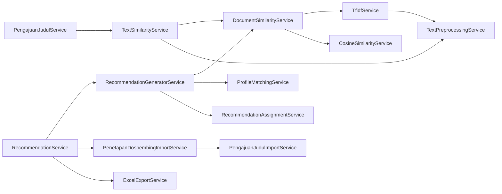

# SERVICES — Penjelasan Semua Service

Seluruh Service berada di folder `app/Services/`. Aturan proyek: **logika bisnis wajib di Service**, Controller hanya delegasi. Berikut penjelasan setiap Service berdasarkan implementasi yang benar-benar ada.

Daftar isi:

1. [TextPreprocessingService](#textpreprocessingservice)
2. [TfidfService](#tfidfservice)
3. [CosineSimilarityService](#cosinesimilarityservice)
4. [DocumentSimilarityService](#documentsimilarityservice)
5. [ProfileMatchingService](#profilematchingservice)
6. [RecommendationAssignmentService](#recommendationassignmentservice)
7. [RecommendationGeneratorService](#recommendationgeneratorservice)
8. [RecommendationService](#recommendationservice)
9. [TextSimilarityService](#textsimilarityservice)
10. [PengajuanJudulService](#pengajuanjudulservice)
11. [PengajuanJudulImportService](#pengajuanjudulimportservice)
12. [GelombangService](#gelombangservice)
13. [DosenProfileService](#dosenprofileservice)
14. [ProfileDosenService](#profiledosenservice)
15. [PenetapanDospembingImportService](#penetapandospembingimportservice)
16. [ExcelExportService](#excelexportservice)
17. [DashboardService](#dashboardservice)

---

## TextPreprocessingService

**File:** `app/Services/TextPreprocessingService.php`

### Tujuan

Melakukan pra-pemrosesan teks (preprocessing) yang menjadi tahap awal dari seluruh perhitungan kemiripan: merapikan teks lalu memecahnya menjadi token sambil membuang stopword (kata umum) Bahasa Indonesia dan Inggris.

### Dipanggil oleh

- `TfidfService` (via `tokenize()` saat membangun matriks).
- `TextSimilarityService` (via `normalize()` untuk perbandingan judul persis).

### Dependency

Tidak ada (murni helper).

### Method

#### normalize(string $text): string

- **Tujuan:** Case folding (semua jadi huruf kecil) + menghapus semua karakter non-alfanumerik.
- **Parameter:** `string $text` — teks mentah.
- **Return:** string bersih (huruf kecil, tanpa tanda baca).
- **Langkah:**
  1. `strtolower($text)` — semua huruf kecil.
  2. `preg_replace('/[^a-z0-9\s]/u', '', $text)` — hapus tanda baca/karakter aneh, sisakan huruf, angka, spasi.
  3. `trim()`.
- **Catatan:** regex tidak menghapus stopword; itu urusan `tokenize`.

#### tokenize(string $text): array

- **Tujuan:** Memecah teks menjadi token (kata) sekaligus menghapus stopword.
- **Parameter:** `string $text`.
- **Return:** `array` daftar token (index dimulai dari 0).
- **Langkah:**
  1. `normalize($text)`.
  2. Jika hasil kosong → `[]`.
  3. `preg_split('/\s+/', $normalized)` → pecah berdasarkan spasi.
  4. Filter token kosong dan token yang ada di konstanta `STOPWORDS` (mis. `yang`, `dan`, `di`, `ke`, `dari`, `untuk`, `pada`, `dengan`, `atau`, dst).
- **Catatan:** stopword disimpan sebagai `private const STOPWORDS` di bagian atas class.

---

## TfidfService

**File:** `app/Services/TfidfService.php`

### Tujuan

Membangun matriks **TF-IDF** dari sekumpulan dokumen. Matriks ini menjadi dasar perhitungan cosine similarity.

### Dipanggil oleh

- `DocumentSimilarityService` (via `buildMatrix()` dan `extractDocumentVector()`).

### Dependency

- `TextPreprocessingService` (untuk tokenisasi dokumen).

### Method

#### buildMatrix(array $documents): array

- **Tujuan:** Menghitung bobot TF-IDF untuk seluruh term di seluruh dokumen.
- **Parameter:** `array $documents` — array string dokumen (index array = index dokumen).
- **Return:** `array` bertingkat: `[term => [indexDokumen => bobot, ...], ...]`.
- **Langkah:**
  1. Tokenisasi semua dokumen → `$tokenizedDocuments`.
  2. Hitung **Document Frequency (DF)**: untuk tiap term, berapa dokumen yang memuat term (pakai `array_unique` per dokumen agar satu dokumen hanya dihitung sekali).
  3. Untuk tiap dokumen, hitung **Term Frequency (TF)** via `termFrequency()`.
  4. Hitung **IDF** dengan formula: `idf = log((N + 1) / (df + 1)) + 1`, dengan `N = jumlah dokumen`.
  5. Bobot TF-IDF = `TF × IDF`, disimpan ke `$matrix[$term][$indexDokumen]`.
- **Catatan:** Formula IDF memakai *smoothed* version (`+1` di pembilang & penyebut) plus `+1` eksternal, sehingga selalu positif. Jika sebuah dokumen token-nya kosong, dokumen itu dilewati (tidak ikut matriks).

#### extractDocumentVector(array $matrix, int $documentIndex): array

- **Tujuan:** Mengambil vektor bobot satu dokumen dari matriks.
- **Parameter:** `$matrix` hasil `buildMatrix()`, `$documentIndex` — index dokumen.
- **Return:** `array [term => bobot, ...]`. Term yang tidak ada di dokumen bernilai `0.0`.
- **Catatan:** Vektor ini siap dipakai `CosineSimilarityService::calculate()`.

#### termFrequency(array $tokens): array *(private)*

- **Tujuan:** Menghitung TF = (jumlah kemunculan term) / (total token).
- **Return:** `array [term => tf]`.

---

## CosineSimilarityService

**File:** `app/Services/CosineSimilarityService.php`

### Tujuan

Menghitung **cosine similarity** antara dua vektor bobot (TF-IDF). Nilai hasil antara `0.0` (tidak mirip) sampai `1.0` (identik).

### Dipanggil oleh

- `DocumentSimilarityService` (via `calculate()`).

### Dependency

Tidak ada (murni matematika).

### Method

#### calculate(array $vectorA, array $vectorB): float

- **Tujuan:** Menghitung kemiripan dua vektor.
- **Parameter:** `array $vectorA`, `array $vectorB` — format `[term => bobot]`.
- **Return:** `float` 0.0 – 1.0.
- **Langkah:**
  1. Gabungkan seluruh term unik dari kedua vektor.
  2. Untuk tiap term: `dotProduct += A × B`, `magnitudeA += A²`, `magnitudeB += B²`.
  3. `magnitudeA = sqrt(magnitudeA)`, `magnitudeB = sqrt(magnitudeB)`.
  4. Jika salah satu magnitude = 0 → return `0.0` (hindari pembagian nol).
  5. Return `dotProduct / (magnitudeA × magnitudeB)`.
- **Rumus:** `cos(θ) = (A · B) / (|A| × |B|)`.

---

## DocumentSimilarityService

**File:** `app/Services/DocumentSimilarityService.php`

### Tujuan

Membungkus TF-IDF + Cosine Similarity menjadi API yang lebih mudah dipakai: membandingkan satu dokumen terhadap satu atau banyak dokumen lain.

### Dipanggil oleh

- `RecommendationGeneratorService` (via `compareOneToMany()` — perbandingan judul vs dokumen semua dosen).
- `TextSimilarityService` (via `compareOneToMany()` — cek judul duplikat).

### Dependency

- `TfidfService`
- `CosineSimilarityService`

### Method

#### compareOneToOne(string $textA, string $textB): float

- **Tujuan:** Bandingkan satu dokumen dengan satu dokumen lain.
- **Parameter:** dua string.
- **Return:** `float` skor similarity.
- **Langkah:** Delegasi ke `compareOneToMany($textA, [$textB])`, ambil `[0]`.

#### compareOneToMany(string $query, array $targets): array

- **Tujuan:** Bandingkan satu query terhadap banyak dokumen target dalam **satu korpus TF-IDF yang sama**.
- **Parameter:** `string $query`, `array $targets` (array string).
- **Return:** `array<int, float>` — skor per target, index selaras dengan `$targets`.
- **Langkah:**
  1. Jika query kosong atau target kosong → array penuh `0.0`.
  2. Gabungkan dokumen: `[query, target1, target2, ...]` → query selalu di index `0`.
  3. `buildMatrix()` → seluruh korpus.
  4. `extractDocumentVector($matrix, 0)` → vektor query.
  5. Loop target: `extractDocumentVector($matrix, index + 1)` lalu `cosineSimilarityService->calculate(queryVector, targetVector)`.
- **Catatan penting:** karena IDF dihitung dari gabungan query + semua target dalam satu matriks, nilai IDF **konsisten** untuk semua target. Inilah yang dipakai pipeline rekomendasi (1 judul vs N dokumen dosen).

---

## ProfileMatchingService

**File:** `app/Services/ProfileMatchingService.php`

### Tujuan

Kalkulator **Profile Matching** murni (pure): menerima data yang sudah di-load (PengajuanJudul, Dosen, nilai similarity, kuota gelombang) dan mengembalikan array berisi seluruh skor untuk satu pasangan pengajuan–dosen. **Tidak melakukan query database maupun persistensi.**

Bobot & tabel skala di-hardcode sebagai konstanta class:

| Kriteria | Sumber nilai | Skala |
|---|---|---|
| Topik Penelitian | Cosine similarity | `similarityToScale()`: ≥0.50→5, ≥0.30→4, ≥0.10→3, ≥0.05→2, else→1 |
| Pendidikan Terakhir | `dosens.pendidikan_terakhir` | S3→5, S2→3, lain→1 |
| Jabatan Fungsional | `dosens.jabatan_fungsional` | Lektor→5, Asisten Ahli→3, Tenaga Pengajar→1 |
| Kuota Bimbingan | sisa kuota (persen) | ≥80%→5, ≥60%→4, ≥40%→3, ≥20%→2, else→1 |

- **Core Factor (CF)** = bobot GAP Topik (60%).
- **Secondary Factor (SF)** = rata-rata bobot GAP Pendidikan, Jabatan, Kuota (40%).
- **Nilai Total** = `CF × 0.6 + SF × 0.4`, dihitung **terpisah** untuk peran dospem1 dan dospem2 karena kuota berbeda per peran.

### Dipanggil oleh

- `RecommendationGeneratorService` (via `buildScoreRow()`, `isEligibleForDospem1()`, `jabatanRank()`).

### Dependency

Tidak ada (murni kalkulator; hanya menerima model Eloquent sebagai data).

### Method

#### buildScoreRow(PengajuanJudul $pengajuan, Dosen $dosen, float $topicSimilarity, ?KuotaDosenGelombang $kuotaGelombang = null): array

- **Tujuan:** Menghitung seluruh skor Profile Matching untuk satu pasangan pengajuan–dosen.
- **Parameter:**
  - `$pengajuan` — data pengajuan (sebenarnya hanya dipakai sebagai konteks; nilai inti adalah `$topicSimilarity`).
  - `$dosen` — kandidat dosen (membutuhkan relasi `programStudi` sudah di-load).
  - `$topicSimilarity` — hasil cosine similarity judul vs dokumen dosen.
  - `$kuotaGelombang` — (opsional) record kuota per gelombang; jika `null` fallback ke kuota lifetime di `dosens`.
- **Return:** array berisi: `topic_similarity`, `topic_scale`, `pendidikan_scale`, `jabatan_scale`, `quota_scale_dospem1/2`, `gap_*`, `bobot_gap_*`, `cf`, `sf_dospem1/2`, `final_score_dospem1/2`, `remaining_kuota_dospem1/2`, `eligible_dospem1`, `jabatan_rank`, plus objek `dosen`.
- **Langkah:**
  1. Konversi atribut ke skala 1-5: `similarityToScale()`, `pendidikanToScale()`, `jabatanToScale()`, `quotaToScale()` (untuk dospem1 dan dospem2).
  2. Hitung GAP = `skala - 5` (`calculateGap()`).
  3. Mapping GAP → bobot via `gapToWeight()` (tabel `GAP_WEIGHT_MAP`, standar Kusrini 2007).
  4. `cf = bobotGapTopik`.
  5. `sfDospem1 = (bobotGapPendidikan + bobotGapJabatan + bobotGapKuotaDospem1) / 3`, begitu pula sfDospem2.
  6. `finalScoreDospem1 = cf * 0.6 + sfDospem1 * 0.4` (dan versi dospem2).
- **Catatan:** `quota_scale` di sini **hanya untuk skor** Profile Matching. Penentuan kuota assignment agar tidak overload dilakukan terpisah oleh `RecommendationAssignmentService`.

#### isEligibleForDospem1(Dosen $dosen): bool

- **Tujuan:** Mengecek apakah dosen layak menjadi Dospem1.
- **Aturan bisnis (hard constraint):** program studi dosen harus **persis** "Teknik Informatika" (case-insensitive).
- **Return:** `true` jika `programStudi->program_studi` (setelah lowercase & trim) bernilai `'teknik informatika'`.

#### jabatanRank(?string $jabatan): int

- **Tujuan:** Memberi rank numerik jabatan untuk hard-rule pairing Dospem1 ≥ Dospem2.
- **Mapping:** `lektor`→3, `asisten ahli`→2, `tenaga pengajar`→1, selainnya→0.

#### Method private pembantu

- `calculateGap(int $profileValue): int` — `nilaiAktual - 5`.
- `gapToWeight(int $gap): float` — lookup `GAP_WEIGHT_MAP`, default `0.5` jika tidak ada mapping.
- `similarityToScale(float $similarity): int` — lihat tabel di atas.
- `pendidikanToScale(?string $pendidikan): int`, `jabatanToScale(?string $jabatan): int`, `quotaToScale(int $remainingQuota, ?int $totalQuota): int`.

---

## RecommendationAssignmentService

**File:** `app/Services/RecommendationAssignmentService.php`

### Tujuan

Bertanggung jawab **murni** atas pemilihan (assignment) Dospem1 & Dospem2 berdasarkan ranking Profile Matching dan sisa kuota. Kuota yang dipakai adalah **state sementara (in-memory)** yang berjalan sepanjang satu batch generate — **bukan** field database.

### Dipanggil oleh

- `RecommendationGeneratorService` (via `initializeQuotaState()` dan `assign()`).

### Dependency

- Model `KuotaDosenGelombang` (query kuota per dosen).

### Method

#### initializeQuotaState(Collection $dosens, int $gelombangId): array

- **Tujuan:** Membangun state kuota awal untuk satu batch generate dari tabel `kuota_dosen_gelombangs`.
- **Parameter:** `$dosens` — koleksi dosen; `$gelombangId`.
- **Return:** `['dospem1' => [dosen_id => sisa], 'dospem2' => [dosen_id => sisa]]`.
- **Langkah:**
  1. Loop setiap dosen, query `KuotaDosenGelombang` untuk pasangan dosen+gelombang.
  2. Jika record tidak ada → dosen tidak masuk state.
  3. `sisa = max(kuota - kuota_terpakai, 0)`; hanya yang `> 0` yang dimasukkan.
- **Catatan:** method ini melakukan **satu query per dosen** (berpotensi N+1). `RecommendationGeneratorService` punya preload `loadKuotaGelombangMap()` sendiri yang lebih efisien, tetapi state di sini di-query ulang — perilaku ini tidak konsisten namun tidak merusak hasil.

#### assign(Collection $rankedDospem1, Collection $rankedDospem2, array &$quotaState): array

- **Tujuan:** Memilih dospem1 & dospem2 untuk satu pengajuan, lalu **mengurangi kuota state secara by-reference** agar berlaku untuk pengajuan berikutnya dalam batch.
- **Parameter:**
  - `$rankedDospem1` — kandidat sudah terurut DESC berdasarkan `final_score_dospem1`.
  - `$rankedDospem2` — kandidat terurut DESC berdasarkan `final_score_dospem2`.
  - `&$quotaState` — state kuota (dimodifikasi langsung).
- **Return:** `['dospem1_row' => ?array, 'dospem2_row' => ?array]`.
- **Langkah:**
  1. `pickDospem1()` → jika ada, `quotaState['dospem1'][id] -= 1`.
  2. `pickDospem2()` → jika ada, `quotaState['dospem2'][id] -= 1`.

#### pickDospem1(Collection $ranked, array $remainingDospem1): ?array *(private)*

- **Aturan Dospem1:**
  - Wajib `eligible_dospem1` (dari Teknik Informatika).
  - Sisa kuota dospem1 `> 0`.
  - Kandidat pertama yang memenuhi = ranking tertinggi (karena sudah terurut DESC).
- **Return:** baris kandidat, atau `null` jika tidak ada yang cocok.

#### pickDospem2(Collection $ranked, array $remainingDospem2, ?array $dospem1Row): ?array *(private)*

- **Aturan Dospem2:**
  - Tidak boleh sama dengan dospem1.
  - Sisa kuota dospem2 `> 0`.
  - Jabatan dospem1 ≥ jabatan dospem2 (via `jabatan_rank`).
  - **Prioritas dosen NON Teknik Informatika** terlebih dahulu (pass 1).
  - Jika semua non-TI habis kuota → fallback ke dosen TI (pass 2).
  - Di antara yang memenuhi syarat, pilih nilai akhir tertinggi (kandidat pertama di list terurut).
- **Langkah:**
  1. Jika `$dospem1Row === null` → return `null` (tidak ada acuan jabatan).
  2. `findBestCandidate($ranked, ..., onlyTi: false)` — pass non-TI.
  3. Jika `null`, `findBestCandidate($ranked, ..., onlyTi: true)` — fallback TI.

#### findBestCandidate(Collection $ranked, array $remainingQuota, array $dospem1Row, bool $onlyTi): ?array *(private)*

- **Tujuan:** Mencari kandidat terbaik yang memenuhi semua filter.
- **Langkah per kandidat (dalam urutan ranking):**
  1. Lewati jika `dosen_id` sama dengan dospem1.
  2. Lewati jika sisa kuota ≤ 0.
  3. Lewati jika `jabatan_rank` dospem1 < jabatan kandidat.
  4. Filter prodi: `$isTi = row['eligible_dospem1']`; jika `onlyTi` tapi bukan TI → lewati; jika `!onlyTi` tapi TI → lewati.
  5. Kandidat pertama lolos = jawaban.

---

## RecommendationGeneratorService

**File:** `app/Services/RecommendationGeneratorService.php`

### Tujuan

**Orkestrator** proses generate rekomendasi untuk satu batch (satu `RiwayatRekomendasi`) sekaligus. Menggabungkan seluruh tahap: similarity → Profile Matching → ranking → assignment → persistensi.

### Dipanggil oleh

- `RecommendationService::generateBatch()`.

### Dependency

- `DocumentSimilarityService`
- `ProfileMatchingService`
- `RecommendationAssignmentService`
- Model: `Dosen`, `PengajuanJudul`, `KuotaDosenGelombang`, `RekomendasiDospembing`, `RiwayatRekomendasi`, `HasilPerhitungan`

### Method

#### generateForBatch(Collection $pengajuans, RiwayatRekomendasi $riwayat): Collection

- **Tujuan:** Menghitung rekomendasi untuk seluruh pengajuan dalam batch, menyimpan hasil, dan mengembalikan ringkasan.
- **Parameter:**
  - `$pengajuans` — koleksi `PengajuanJudul` (harus sudah berstatus disetujui).
  - `$riwayat` — record `RiwayatRekomendasi` (status draft) tempat hasil digantungkan.
- **Return:** `Collection` ringkasan hasil per pengajuan (`riwayat_rekomendasi_id`, `rekomendasi_id`, `pengajuan_id`, `dospem1`, `dospem2`, skor).
- **Langkah:**
  1. `loadMissing('mahasiswa.programStudi')` pada pengajuan.
  2. `loadDosenCandidates()` — eager load semua dosen + `programStudi` + `profile`.
  3. Ambil `gelombangId` dari pengajuan pertama.
  4. `loadKuotaGelombangMap()` — satu query kuota per gelombang untuk semua dosen.
  5. `assignmentService->initializeQuotaState()` — state kuota sementara.
  6. Loop setiap pengajuan:
     - `buildRankedCandidates()` → `[rankedDospem1, rankedDospem2]`.
     - `assignmentService->assign(...)` → dospem terpilih.
     - `RekomendasiDospembing::create()` → simpan dospem1/dospem2 + skor + `ringkasan` (judul & nama mahasiswa).
     - `buildHasilPerhitunganRows()` → baris ranking **semua kandidat** (dospem1 & dospem2).
  7. `bulkInsertHasilPerhitungan()` — insert chunk 500.

#### loadDosenCandidates(): Collection *(private)*

- Eager load `Dosen::with(['programStudi', 'profile'])->get()` sekali untuk seluruh batch.

#### loadKuotaGelombangMap(Collection $dosens, int $gelombangId): array *(private)*

- Satu query `KuotaDosenGelombang` untuk semua dosen, di-`keyBy('dosen_id')`.

#### buildRankedCandidates(PengajuanJudul $pengajuan, Collection $dosens, array $kuotaGelombangMap): array *(private)*

- **Return:** `[rankedDospem1, rankedDospem2]`.
- **Langkah:**
  1. Ambil `dokumen_tfidf` setiap dosen → `$dokumenTfidfList`.
  2. `documentSimilarityService->compareOneToMany($pengajuan->judul_skripsi, $dokumenTfidfList)` → skor similarity per dosen.
  3. `profileMatchingService->buildScoreRow(...)` untuk tiap dosen → `$scores`.
  4. `sortByDesc('final_score_dospem1')` dan `sortByDesc('final_score_dospem2')`.

#### buildHasilPerhitunganRows(...) *(private)*

- Menyusun array baris insert untuk `hasil_perhitungans`: similarity, skala-skala, cf, sf, final_score, ranking, dan `detail` (JSON semua field kecuali objek `dosen`).

#### bulkInsertHasilPerhitungan(array $rows): void *(private)*

- Insert massal dengan chunk 500 untuk menghindari N+1.

#### stripDosenObject(array $row): array *(private)*

- Menghapus kunci `dosen` dari array agar tidak ikut di-JSON-kan.

---

## RecommendationService

**File:** `app/Services/RecommendationService.php`

### Tujuan

**Facade service** untuk urusan rekomendasi: satu-satunya service yang boleh dipanggil langsung oleh Controller (khususnya `RekomendasiController`). Menyembunyikan detail orchestrasi & finalisasi.

### Dipanggil oleh

- `RekomendasiController`

### Dependency

- `RecommendationGeneratorService`
- `ExcelExportService`
- `PenetapanDospembingImportService`
- `PenetapanDospembingImport` (class import Excel)
- `Maatwebsite\Excel`

### Method

#### generateBatch(Collection $pengajuans): Collection

- **Tujuan:** Generate rekomendasi untuk satu batch.
- **Langkah:**
  1. `Auth::id()` → `generated_by`.
  2. `DB::transaction`: buat `RiwayatRekomendasi` (status `draft`, keterangan "Batch rekomendasi dospem generated oleh admin.").
  3. Delegasi ke `generatorService->generateForBatch($pengajuans, $riwayat)`.

#### exportLatestToExcel(): BinaryFileResponse

- Export riwayat **terbaru** ke Excel → `excelExportService->exportLatest()`.

#### finalizeFromImport(UploadedFile $file): void

- Import Excel hasil rekomendasi lalu finalisasi → `Excel::import(new PenetapanDospembingImport($penetapanDospembingImportService), $file)`.

#### finalizeDraft(RiwayatRekomendasi $riwayat): void

- Finalisasi riwayat draft langsung dari database → `penetapanDospembingImportService->finalizeDraft($riwayat)`.

#### exportRiwayat(RiwayatRekomendasi $riwayat): BinaryFileResponse

- Export satu riwayat tertentu → `excelExportService->export($riwayat)`.

---

## TextSimilarityService

**File:** `app/Services/TextSimilarityService.php`

### Tujuan

Mengecek kemiripan judul skripsi antar mahasiswa (anti plagiarisme). **Bukan bagian** dari pipeline rekomendasi dosen — hanya dipakai saat pengajuan/update judul.

### Dipanggil oleh

- `PengajuanJudulService` (via `checkSimilarity()`).

### Dependency

- `DocumentSimilarityService`
- `TextPreprocessingService`
- Model `PengajuanJudul`

### Method

#### checkSimilarity(string $judulBaru, ?int $excludePengajuanId = null, ?int $excludeMahasiswaId = null): array

- **Tujuan:** Menilai apakah `$judulBaru` mirip dengan judul yang sudah "resmi" (`status = 'disetujui'`).
- **Parameter:**
  - `$judulBaru` — judul yang diajukan.
  - `$excludePengajuanId` — abaikan satu pengajuan (saat edit judul sendiri).
  - `$excludeMahasiswaId` — abaikan seluruh judul milik mahasiswa tertentu (saat pengajuan ulang setelah ditolak).
- **Return:** `['is_similar' => bool, 'percent' => float, 'matched_title' => ?string]`.
- **Langkah:**
  1. Jika judul kosong → hasil "tidak mirip".
  2. Ambil semua judul berstatus `disetujui` (kecuali yang di-exclude).
  3. Jika tidak ada → hasil "tidak mirip".
  4. **Cek cepat:** jika judul yang di-`normalize()` sama persis → mirip 100%.
  5. Jika tidak, `compareOneToMany($judulBaru, daftarJudul)` → cari similarity tertinggi.
  6. Mirip jika similarity ≥ **75%** (`DUPLICATE_THRESHOLD = 0.75`).
- **Catatan:** status `pending`/`ditolak` diabaikan, sehingga mahasiswa bisa mengajukan ulang judul yang ditolak atau merevisi judulnya sendiri tanpa false positive.

---

## PengajuanJudulService

**File:** `app/Services/PengajuanJudulService.php`

### Tujuan

Seluruh operasi CRUD & status pada `PengajuanJudul`: membuat, mengupdate, menghapus, approve, reject.

### Dipanggil oleh

- `PengajuanJudulController` (create/update/delete)
- `PengajuanValidasiController` (approve/reject/approveAll)

### Dependency

- `TextSimilarityService`

### Method

#### create(Mahasiswa $mahasiswa, Gelombang $gelombang, string $judulSkripsi, UploadedFile $fileProposal): PengajuanJudul

- **Tujuan:** Membuat pengajuan baru.
- **Langkah:**
  1. Cek kemiripan judul (`checkSimilarity`, `excludeMahasiswaId` = mahasiswa ini). Jika mirip → `ValidationException`.
  2. Simpan file proposal via `storeProposalFile()`.
  3. `PengajuanJudul::create([...status = 'pending'])`.

#### update(PengajuanJudul $pengajuan, string $judulSkripsi, ?UploadedFile $fileProposal = null): void

- Hanya cek kemiripan **jika judul berubah** (exclude pengajuan sendiri + mahasiswa sendiri).
- Jika ada file baru, hapus file lama lalu simpan file baru.

#### delete(PengajuanJudul $pengajuan): void

- Hapus file proposal dari storage lalu `delete()` record.

#### approve(PengajuanJudul $pengajuan, User $validator): void

- Delegasi ke `$pengajuan->approve($validator)` (status → `disetujui`).

#### approveAll(Collection $pengajuans, User $validator): int

- Approve semua yang masih `pending` dalam satu transaksi. Return jumlah yang disetujui.

#### reject(PengajuanJudul $pengajuan, User $validator, string $alasan): void

- Delegasi ke `$pengajuan->reject($validator, $alasan)` (status → `ditolak` + alasan).

#### storeProposalFile(UploadedFile $file, string $nim, string $nama): string *(private)*

- Nama file = slug `nim_nama.ext`, disimpan ke disk `public`, folder `proposal/`.

---

## PengajuanJudulImportService

**File:** `app/Services/PengajuanJudulImportService.php`

### Tujuan

Import massal data pengajuan judul dari file Excel (kolom: `nim`, `nama_mahasiswa`, `program_studi`, `judul_skripsi`). Import hanya boleh dilakukan jika ada gelombang aktif.

### Dipanggil oleh

- `Admin\PengajuanJudulManajemenController::import()`.

### Dependency

- `PengajuanJudulImport` (class import Excel)
- Model `Gelombang`

### Method

#### import(UploadedFile $file): PengajuanJudulImport

- **Langkah:**
  1. `Gelombang::active()->first()`; jika tidak ada → `ValidationException`.
  2. Buat instance `PengajuanJudulImport($gelombang)`.
  3. `Excel::import()` dalam `DB::transaction`.
  4. Return instance import (berisi counter: `mahasiswaCreated`, `submissionsCreated`, `errors`, dst).

**Aturan import** (di dalam `PengajuanJudulImport::collection()` / `processPengajuan()`):
- Mahasiswa baru dibuat (user + role `mahasiswa`, password = NIM), mahasiswa lama di-update.
- Satu mahasiswa hanya boleh punya satu pengajuan per gelombang:
  - Belum ada → create (pending).
  - Masih `pending` → judul di-update.
  - `ditolak` → judul di-update, status direset ke pending.
  - `disetujui` → dilewati (tidak boleh diubah lewat import).

---

## GelombangService

**File:** `app/Services/GelombangService.php`

### Tujuan

Mengelola `Gelombang` (periode pengajuan). Menegakkan aturan: **hanya satu gelombang aktif** dalam satu waktu.

### Dipanggil oleh

- `GelombangController` (create/update/toggle/delete)
- `PengajuanJudulController` (getOpenGelombang saat mahasiswa submit)

### Dependency

Tidak ada (langsung Model).

### Method

- `create(array $data): Gelombang` — jika `is_active` true, nonaktifkan gelombang lain dulu.
- `update(Gelombang $gelombang, array $data): Gelombang` — sama, tapi kecuali dirinya sendiri.
- `toggleStatus(Gelombang $gelombang): Gelombang` — membalik `is_active`; jika jadi aktif, nonaktifkan yang lain.
- `delete(Gelombang $gelombang): void`.
- `getOpenGelombang(): ?Gelombang` — gelombang `is_active = true` **dan** hari ini di antara `tanggal_mulai`–`tanggal_selesai`.
- `isOpen(): bool` — ada tidaknya gelombang terbuka.

---

## DosenProfileService

**File:** `app/Services/DosenProfileService.php`

### Tujuan

Membangun & menyimpan **dokumen teks per dosen** (`dosen_profiles.dokumen_tfidf`) yang menjadi "kandidat dokumen" pada perhitungan cosine similarity. Nama method `syncDokumenTfidf` agak menyesatkan — yang tersimpan adalah **dokumen mentah** (belum dihitung TF-IDF-nya).

### Dipanggil oleh

- `DosenController` (store/update dosen — admin).
- `ProfileDosenService::update()` (dosen mengubah profil sendiri).

### Dependency

Tidak ada (langsung Model).

### Method

#### syncDokumenTfidf(Dosen $dosen): DosenProfile

- **Tujuan:** Hitung ulang `dokumen_tfidf` dari data terbaru lalu simpan.
- **Langkah:**
  1. `$dosen->load(['bidangKeahlians', 'profile'])` (gunakan `load`, bukan `loadMissing`, agar selalu fresh).
  2. Pastikan profile ada (`updateOrCreate` kosong).
  3. `$profile->dokumen_tfidf = generateDokumenTfidf($dosen, $profile)`, lalu `save()`.

#### generateDokumenTfidf(Dosen $dosen, ?DosenProfile $profile = null): string

- **Tujuan:** Menggabungkan bidang keahlian + topik_metode + judul_penelitian jadi satu string.
- **Langkah:**
  1. Nama semua bidang keahlian di-`implode(' ')`.
  2. Gabung `[bidangKeahlian, topik_metode, judul_penelitian]`, buang bagian kosong.
  3. Rapikan spasi berlebih (`preg_replace('/\s+/', ' ')`).

> **Catatan penting:** ini **bukan** nilai TF-IDF. Bobot TF-IDF & IDF dihitung ulang setiap proses generate (lihat `DocumentSimilarityService::compareOneToMany`), jadi tidak ada langkah re-index manual.

---

## ProfileDosenService

**File:** `app/Services/ProfileDosenService.php`

### Tujuan

Mengupdate profil dosen yang sedang login (menu "Profil Saya" dosen). Hanya menyentuh field yang boleh diubah dosen sendiri: `no_hp`, bidang keahlian, `topik_metode`, `judul_penelitian`. Data administratif (NIDN, nama, prodi, jabatan, pendidikan, kuota) **tidak disentuh** — wewenang admin.

### Dipanggil oleh

- `ProfileDosenController`.

### Dependency

- `DosenProfileService` (untuk regen `dokumen_tfidf`).

### Method

#### update(Dosen $dosen, array $data): Dosen

- **Parameter:** `$data` berisi `no_hp`, `bidang_keahlian_ids`, `topik_metode`, `judul_penelitian`.
- **Langkah:**
  1. `DB::transaction`.
  2. Update `no_hp`.
  3. `sync()` bidang keahlian.
  4. `profile()->updateOrCreate(...)`.
  5. `dosenProfileService->syncDokumenTfidf($dosen)` — dokumen dosen di-generate ulang.
- **Return:** `$dosen->fresh(['profile', 'bidangKeahlians', 'programStudi'])`.

---

## PenetapanDospembingImportService

**File:** `app/Services/PenetapanDospembingImportService.php`

### Tujuan

**Satu-satunya jalur yang menulis `kuota_terpakai_*` ke database.** Bertanggung jawab atas finalisasi penetapan dosen pembimbing, baik dari file Excel import maupun langsung dari draft di database. Mengelola pola `releaseQuota` (lepas kuota lama) → `consumeQuota` (pakai kuota baru) agar tidak dobel hitung.

### Dipanggil oleh

- `RecommendationService` (via `finalizeDraft()` dan `finalizeFromImport()`)
- `PenetapanDospembingImport` (class import Excel memanggil `finalize($rows)`)

### Dependency

- Model: `Dosen`, `KuotaDosenGelombang`, `PenetapanDospembing`, `PengajuanJudul`, `RekomendasiDospembing`, `RiwayatRekomendasi`

### Method

#### finalize(Collection $rows): void

- **Tujuan:** Finalisasi dari file Excel import.
- **Langkah:**
  1. Tolak jika file kosong.
  2. Normalisasi header kolom (`normalizeRow()` — terima beberapa varian nama kolom).
  3. Pastikan kolom wajib ada: `riwayat_rekomendasi_id`, `rekomendasi_dospembing_id`, `final_nidn_dospem_1`, `final_nidn_dospem_2`.
  4. File hanya boleh berisi **satu** `riwayat_rekomendasi_id` (pisahkan file per batch).
  5. Load riwayat + `rekomendasiDospembings.pengajuan.mahasiswa.programStudi`.
  6. `validateRows()` — validasi semua baris, kumpulkan error (pengajuan ditemukan? rekomendasi cocok? dospem1 ≠ dospem2?).
  7. Jika ada error → `ValidationException` dengan daftar error per baris.
  8. `DB::transaction`:
     - `buildContext()` → preload pengajuan, dosen, rekomendasi.
     - `prepareRows()` → baris siap proses.
     - Untuk tiap baris: `releaseQuota()` penetapan lama → `PenetapanDospembing::updateOrCreate(['pengajuan_id' => ...], [... 'sumber' => 'import'])` → `consumeQuota()`.
     - Riwayat → `status = 'finalized'`.

#### finalizeDraft(RiwayatRekomendasi $riwayat): void

- **Tujuan:** Finalisasi draft langsung dari database (tanpa file import).
- **Langkah:**
  1. Tolak jika riwayat sudah `finalized`.
  2. Ambil semua `rekomendasiDospembings` pada riwayat; tolak jika kosong.
  3. `DB::transaction`: untuk tiap rekomendasi → `releaseQuota` → `updateOrCreate` (`sumber = 'manual'`, catatan dari `ringkasan.catatan`) → `consumeQuota`.
  4. Riwayat → `status = 'finalized'`.

#### validateRows(Collection $rows, RiwayatRekomendasi $riwayat): array *(private)*

- Validasi per baris: pengajuan ditemukan, tidak duplikat dalam file, rekomendasi cocok dengan pengajuan, NIDN dospem1/2 diisi, dosen ditemukan, dospem1 ≠ dospem2. Return array error.

#### prepareRows(Collection $rows, array $context): array *(private)*

- Menyusun array `['pengajuan', 'rekomendasi', 'dospem1', 'dospem2', 'catatan']` per baris.

#### buildContext(Collection $rows, RiwayatRekomendasi $riwayat): array *(private)*

- Preload: `pengajuansById`, `pengajuansByNim`, `dosensByNidn`, `rekomendasiById`, `rekomendasiByRiwayatPengajuanKey` (untuk lookup O(1)).

#### resolvePengajuan / resolveRekomendasi *(private)*

- Menemukan pengajuan/rekomendasi dari baris Excel berdasarkan beberapa identitas (id rekomendasi → id pengajuan → NIM).

#### releaseQuota(?PenetapanDospembing $penetapan): void *(private)*

- Jika ada penetapan lama: decrement `kuota_terpakai_dospem1/2` pada `dosens` dan `kuota_dosen_gelombangs` (jika ada `gelombang_id`).

#### consumeQuota(PenetapanDospembing $penetapan): void *(private)*

- Increment `kuota_terpakai_dospem1/2` pada `dosens` dan `kuota_dosen_gelombangs`.

#### normalizeRow / ensureRequiredColumns / readValue / buildRecommendationKey / normalizeCatatan *(private)*

- Helper untuk normalisasi header kolom, cek kolom wajib, baca nilai fleksibel, dsb.

---

## ExcelExportService

**File:** `app/Services/ExcelExportService.php`

### Tujuan

Menghasilkan file Excel rekomendasi.

### Dipanggil oleh

- `RecommendationService`.

### Dependency

- `RekomendasiDospemExport` (class export)
- `Maatwebsite\Excel`

### Method

- `exportLatest(): BinaryFileResponse` — ambil `RiwayatRekomendasi::latest()`, `abort_unless` 404 jika belum ada, lalu `export()`.
- `export(RiwayatRekomendasi $riwayat): BinaryFileResponse` — unduh `rekomendasi-dospem-{timestamp}.xlsx`.

---

## DashboardService

**File:** `app/Services/DashboardService.php`

### Tujuan

Menyiapkan data tampilan dashboard berdasarkan role. **Read-only** — hanya query & agregasi.

### Dipanggil oleh

- `DashboardController::index()`.

### Dependency

- Model: `BidangKeahlian`, `Dosen`, `Gelombang`, `Mahasiswa`, `PenetapanDospembing`, `PengajuanJudul`, `RiwayatRekomendasi`, `User`

### Method

- `forAdmin(): array` — summary cards, chart status pengajuan, chart jabatan, chart pengajuan per gelombang, top dosen, pengajuan terbaru, aktivitas (dari `riwayat_rekomendasis` + `penetapan_dospembings`).
- `forDosen(User $user): array` — data dosen login, daftar bimbingan dari `penetapan_dospembings` (hanya yang riwayatnya `finalized`), jumlah dospem1/dospem2, sisa kuota.
- `forMahasiswa(User $user): array` — data mahasiswa, pengajuan terakhir + relasi rekomendasi & penetapan, timeline proses, dospem1/dospem2 yang ditetapkan.

---

## Peta Dependency Antar Service

