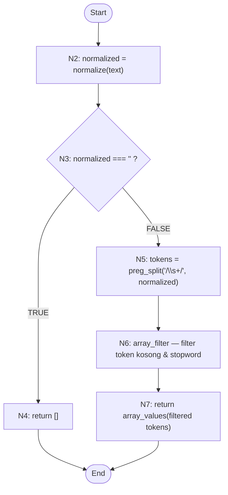
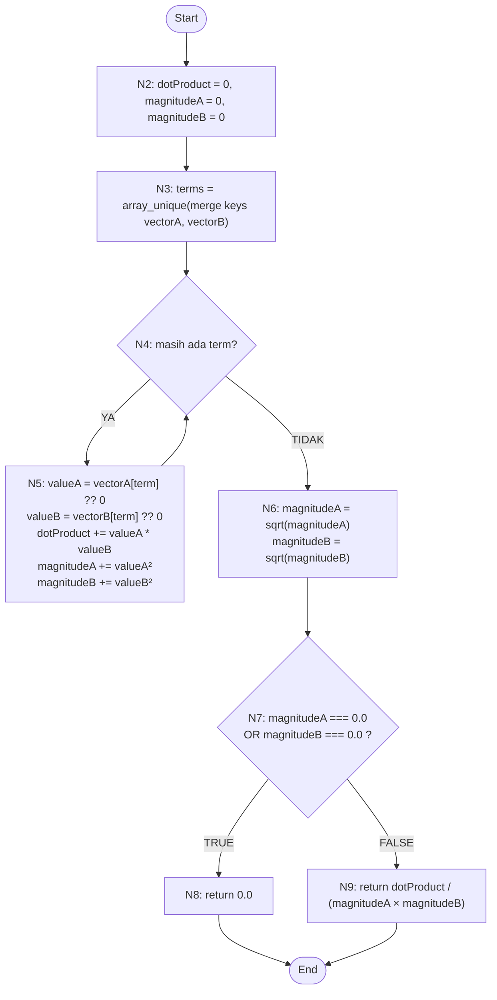
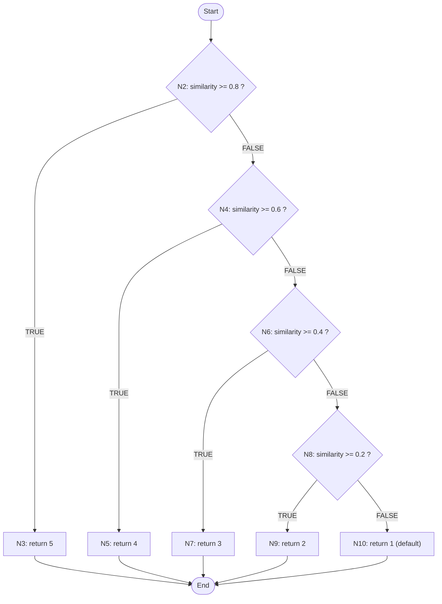
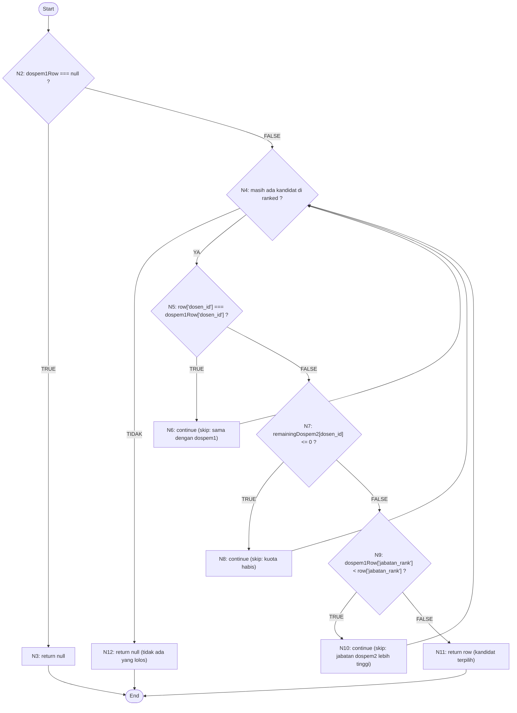

# BAB V — PENGUJIAN SISTEM

## 5.x White Box Testing

White Box Testing (pengujian kotak putih) merupakan metode pengujian perangkat lunak yang berfokus pada verifikasi logika internal program. Berbeda dengan Black Box Testing yang hanya menguji fungsionalitas dari luar, White Box Testing memeriksa struktur kode, aliran kontrol (*control flow*), dan jalur eksekusi di dalam method/fungsi. Metode ini relevan diterapkan pada sistem rekomendasi dosen pembimbing ini karena inti penelitian melibatkan algoritma kompleks — TF-IDF, Cosine Similarity, dan Profile Matching — yang menuntut setiap cabang logika dan jalur independen diuji ketepatannya.

Pendekatan yang digunakan adalah **Basis Path Testing** dengan langkah-langkah:
1. Membangun *Flow Graph* berdasarkan source code.
2. Menghitung *Cyclomatic Complexity* V(G).
3. Menentukan *Independent Path* sejumlah V(G).
4. Merancang *Test Case* untuk masing-masing jalur.

---

## TAHAP 1 — Identifikasi Source Code Algoritma Inti

Berdasarkan analisis seluruh source code proyek Laravel yang berlokasi di `app/Services/`, ditemukan method-method berikut yang mengimplementasikan algoritma penelitian:

| No | Nama File | Class | Method | Algoritma |
|----|-----------|-------|--------|-----------|
| 1 | `TextPreprocessingService.php` | `TextPreprocessingService` | `tokenize()` | Preprocessing teks: normalisasi, tokenisasi, stopword removal |
| 2 | `TfidfService.php` | `TfidfService` | `buildMatrix()` | Pembobotan TF-IDF (Term Frequency-Inverse Document Frequency) |
| 3 | `CosineSimilarityService.php` | `CosineSimilarityService` | `calculate()` | Cosine Similarity antar vektor dokumen |
| 4 | `ProfileMatchingService.php` | `ProfileMatchingService` | `buildScoreRow()` | Profile Matching: GAP, Core Factor, Secondary Factor, Nilai Akhir |
| 5 | `RecommendationAssignmentService.php` | `RecommendationAssignmentService` | `pickDospem2()` | Seleksi Dospem2 berdasarkan hard-rule ranking dan kuota |

> **Catatan**: Method seperti CRUD Mahasiswa, Login, Logout, Dashboard, dan operasi import/export tidak diuji karena tidak mengandung algoritma penelitian.

---

## 5.x.1 Pengujian Modul 1 — `tokenize()` (TextPreprocessingService)

### A. Deskripsi Method

| Atribut | Keterangan |
|---------|-----------|
| **Tujuan** | Mengubah teks mentah menjadi array token yang bersih, siap digunakan oleh TF-IDF |
| **Fungsi** | Melakukan normalisasi teks (lowercase, hapus karakter non-alfanumerik), tokenisasi (pemisahan berdasarkan spasi), dan stopword removal |
| **Parameter** | `string $text` — teks input (judul skripsi atau dokumen dosen) |
| **Output** | `array` — daftar token berupa kata-kata bermakna setelah preprocessing |

**Lokasi File**: [`app/Services/TextPreprocessingService.php`](file:///d:/TeguhBagas/project/rekomendasi-dospem/app/Services/TextPreprocessingService.php)

### B. Analisis Algoritma

```php
public function tokenize(string $text): array
{
    $normalized = $this->normalize($text);       // [1] Normalisasi

    if ($normalized === '') {                    // [2] Cek string kosong
        return [];                               // [3] Kembalikan array kosong
    }

    $tokens = preg_split('/\s+/', $normalized) ?: [];  // [4] Split whitespace

    return array_values(array_filter(           // [5] Filter stopword
        $tokens,
        fn (string $token): bool => $token !== '' && !in_array($token, self::STOPWORDS, true)
    ));
}
```

Logika algoritma:
1. Teks di-normalisasi: diubah ke *lowercase* dan semua karakter non-alfanumerik dihapus.
2. Jika hasil normalisasi adalah string kosong, kembalikan array kosong (early return).
3. Teks dinormalisasi dipecah berdasarkan spasi (`\s+`).
4. Setiap token difilter: hapus string kosong dan kata-kata yang terdaftar sebagai *stopword*.

### 5.x.2 Flow Graph — `tokenize()`

**Identifikasi Node dan Edge:**

| Node | Deskripsi |
|------|-----------|
| N1 | Start — masuk ke method `tokenize()` |
| N2 | Panggil `normalize($text)` → simpan ke `$normalized` |
| N3 | Kondisi: `$normalized === ''`? |
| N4 | Return `[]` (true branch) |
| N5 | `preg_split('/\s+/', $normalized)` → `$tokens` |
| N6 | `array_filter` + `array_values` (filter stopword) |
| N7 | Return hasil token |
| N8 | End |

**Edge:**
- E1: N1 → N2
- E2: N2 → N3
- E3: N3 → N4 (kondisi TRUE)
- E4: N3 → N5 (kondisi FALSE)
- E5: N4 → N8
- E6: N5 → N6
- E7: N6 → N7
- E8: N7 → N8



### 5.x.3 Cyclomatic Complexity — `tokenize()`

**Metode 1: Rumus V(G) = E − N + 2**

- E (jumlah edge) = 8
- N (jumlah node) = 8

$$V(G) = E - N + 2 = 8 - 8 + 2 = \mathbf{2}$$

**Metode 2: Rumus V(G) = P + 1**

- P (jumlah *predicate node*) = 1 (yaitu node N3: `$normalized === ''`)

$$V(G) = P + 1 = 1 + 1 = \mathbf{2}$$

> **Kedua metode menghasilkan nilai yang sama: V(G) = 2**, artinya terdapat 2 jalur independen yang harus diuji.

### 5.x.4 Independent Path — `tokenize()`

```
Path 1 (teks kosong):
N1 → N2 → N3 → N4 → N8

Path 2 (teks valid):
N1 → N2 → N3 → N5 → N6 → N7 → N8
```

### 5.x.5 Test Case — `tokenize()`

| No | Independent Path | Kondisi Pengujian | Input | Output yang Diharapkan | Output Aktual | Status |
|----|-----------------|-------------------|-------|----------------------|---------------|--------|
| 1 | Path 1: N1→N2→N3→N4→N8 | Teks kosong, normalisasi menghasilkan string `''` | `""` (string kosong) | `[]` (array kosong) | `[]` | ✅ Valid |
| 2 | Path 2: N1→N2→N3→N5→N6→N7→N8 | Teks valid dengan stopword dan karakter khusus | `"Sistem Rekomendasi Dosen Pembimbing Menggunakan Metode"` | `["sistem","rekomendasi","dosen","pembimbing","metode"]` | `["sistem","rekomendasi","dosen","pembimbing","metode"]` | ✅ Valid |

### 5.x.6 Hasil Pengujian — `tokenize()`

Pengujian White Box Testing pada method `tokenize()` milik class `TextPreprocessingService` menghasilkan dua jalur independen sesuai dengan nilai *Cyclomatic Complexity* V(G) = 2. Kedua jalur berhasil dieksekusi dan diverifikasi.

Pada **Path 1**, saat teks input kosong (`""`), method `normalize()` mengembalikan string kosong, sehingga kondisi `$normalized === ''` bernilai **TRUE** dan method segera mengembalikan array kosong `[]` tanpa melanjutkan proses tokenisasi. Perilaku ini memastikan tidak ada kesalahan saat sistem menerima judul skripsi yang belum diisi.

Pada **Path 2**, teks valid seperti `"Sistem Rekomendasi Dosen Pembimbing Menggunakan Metode"` diproses melalui seluruh tahapan preprocessing: normalisasi menjadi lowercase, splitting berdasarkan spasi, lalu filtering stopword (kata `"menggunakan"` terdaftar sebagai stopword dan berhasil dihapus). Hasilnya adalah token bermakna yang siap diproses TF-IDF.

Tidak ditemukan *logical error* pada method ini. Seluruh percabangan telah diuji dan algoritma menghasilkan output sesuai rancangan sistem.

---

## 5.x.1 Pengujian Modul 2 — `buildMatrix()` (TfidfService)

### A. Deskripsi Method

| Atribut | Keterangan |
|---------|-----------|
| **Tujuan** | Membangun matriks bobot TF-IDF dari kumpulan dokumen teks |
| **Fungsi** | Menghitung nilai TF (frekuensi term dalam dokumen) dan IDF (invers frekuensi dokumen), lalu mengalikannya untuk menghasilkan bobot TF-IDF setiap term pada setiap dokumen |
| **Parameter** | `array $documents` — array string dokumen (indeks 0 = query/judul skripsi, indeks 1..n = dokumen dosen) |
| **Output** | `array` — matriks dua dimensi: `[term => [docIndex => weight]]` |

**Lokasi File**: [`app/Services/TfidfService.php`](file:///d:/TeguhBagas/project/rekomendasi-dospem/app/Services/TfidfService.php)

### B. Analisis Algoritma

```php
public function buildMatrix(array $documents): array
{
    // [1] Tokenize setiap dokumen
    $tokenizedDocuments = array_map(
        fn ($document): array => $this->preprocessingService->tokenize((string) $document),
        $documents
    );

    $documentCount = count($tokenizedDocuments); // [2] Hitung jumlah dokumen

    if ($documentCount === 0) {                  // [3] Guard: dokumen kosong
        return [];                               // [4] Return matriks kosong
    }

    // [5] Hitung Document Frequency (DF) setiap term
    $documentFrequency = [];
    foreach ($tokenizedDocuments as $tokens) {
        foreach (array_unique($tokens) as $term) {
            $documentFrequency[$term] = ($documentFrequency[$term] ?? 0) + 1;
        }
    }

    // [6] Hitung TF-IDF untuk setiap term di setiap dokumen
    $matrix = [];
    foreach ($tokenizedDocuments as $documentIndex => $tokens) {
        if ($tokens === []) {                    // [7] Skip dokumen tanpa token
            continue;                            // [8] lanjut ke dokumen berikutnya
        }

        foreach ($this->termFrequency($tokens) as $term => $frequency) {
            $idf = log(($documentCount + 1) / (($documentFrequency[$term] ?? 0) + 1)) + 1; // [9] Hitung IDF
            $matrix[$term][$documentIndex] = $frequency * $idf;  // [10] Simpan bobot TF-IDF
        }
    }

    return $matrix; // [11] Return matriks
}
```

Logika algoritma:
1. Setiap dokumen di-tokenisasi menggunakan `TextPreprocessingService`.
2. Jika tidak ada dokumen (`$documentCount === 0`), return matriks kosong.
3. Dihitung *Document Frequency* (DF) setiap term — berapa dokumen memuat term tersebut.
4. Untuk setiap dokumen yang memiliki token, dihitung TF (term frequency relatif) dan IDF menggunakan rumus *smoothed IDF*: `IDF = log((N+1)/(df+1)) + 1`.
5. Bobot TF-IDF = TF × IDF disimpan ke matriks.

### 5.x.2 Flow Graph — `buildMatrix()`

**Identifikasi Node dan Edge:**

| Node | Deskripsi |
|------|-----------|
| N1 | Start — masuk method |
| N2 | Tokenisasi semua dokumen dengan `array_map` |
| N3 | Hitung `$documentCount` |
| N4 | Kondisi: `$documentCount === 0`? |
| N5 | Return `[]` (true branch) |
| N6 | Inisialisasi loop DF: `foreach $tokenizedDocuments` |
| N7 | Kondisi: masih ada dokumen di loop DF? |
| N8 | Loop inner: `foreach array_unique($tokens) as $term` → akumulasi DF |
| N9 | Inisialisasi loop matriks: `foreach $tokenizedDocuments` |
| N10 | Kondisi: masih ada dokumen di loop matriks? |
| N11 | Kondisi: `$tokens === []`? |
| N12 | `continue` — lewati dokumen ini |
| N13 | Loop inner TF-IDF: `foreach termFrequency($tokens)` |
| N14 | Hitung IDF dan simpan bobot ke `$matrix` |
| N15 | Return `$matrix` |
| N16 | End |

**Edge:**
- E1: N1→N2, E2: N2→N3, E3: N3→N4
- E4: N4→N5 (TRUE), E5: N4→N6 (FALSE)
- E6: N5→N16
- E7: N6→N7, E8: N7→N8 (ada dokumen), E9: N7→N9 (habis)
- E10: N8→N7 (loop back)
- E11: N9→N10, E12: N10→N11 (ada dokumen), E13: N10→N15 (habis)
- E14: N11→N12 (TRUE/kosong), E15: N11→N13 (FALSE)
- E16: N12→N10 (continue → iterasi berikutnya)
- E17: N13→N14, E18: N14→N13 (loop inner)
- E19: N13→N10 (loop inner habis → back ke outer)
- E20: N15→N16

Total: E = 20, N = 16

```mermaid
flowchart TD
    N1([Start]) --> N2["N2: tokenizedDocuments = array_map(tokenize, documents)"]
    N2 --> N3["N3: documentCount = count(tokenizedDocuments)"]
    N3 --> N4{N4: documentCount === 0 ?}
    N4 -- TRUE --> N5["N5: return []"]
    N4 -- FALSE --> N6["N6: documentFrequency = []"]
    N5 --> N16([End])
    N6 --> N7{N7: ada dokumen di loop DF?}
    N7 -- YA --> N8["N8: foreach unique tokens → akumulasi DF"]
    N8 --> N7
    N7 -- TIDAK --> N9["N9: matrix = []"]
    N9 --> N10{N10: ada dokumen di loop matrix?}
    N10 -- YA --> N11{N11: tokens === [] ?}
    N11 -- TRUE --> N12["N12: continue"]
    N12 --> N10
    N11 -- FALSE --> N13{N13: ada term di termFrequency?}
    N13 -- YA --> N14["N14: hitung IDF, simpan matrix[term][docIndex]"]
    N14 --> N13
    N13 -- TIDAK --> N10
    N10 -- TIDAK --> N15["N15: return matrix"]
    N15 --> N16
```

### 5.x.3 Cyclomatic Complexity — `buildMatrix()`

**Metode 1: Rumus V(G) = E − N + 2**

- E (jumlah edge) = 20
- N (jumlah node) = 16

$$V(G) = E - N + 2 = 20 - 16 + 2 = \mathbf{6}$$

**Metode 2: Rumus V(G) = P + 1**

Predicate node (simpul keputusan):
- P1: N4 — `$documentCount === 0`
- P2: N7 — iterasi loop DF
- P3: N10 — iterasi loop matriks
- P4: N11 — `$tokens === []`
- P5: N13 — iterasi loop inner TF-IDF

P = 5

$$V(G) = P + 1 = 5 + 1 = \mathbf{6}$$

> **Kedua metode menghasilkan nilai yang sama: V(G) = 6**, artinya terdapat 6 jalur independen.

### 5.x.4 Independent Path — `buildMatrix()`

```
Path 1 (array dokumen kosong):
N1 → N2 → N3 → N4(TRUE) → N5 → N16

Path 2 (satu dokumen, tokennya kosong semua):
N1 → N2 → N3 → N4(FALSE) → N6 → N7(YA) → N8 → N7(TIDAK) → N9 
   → N10(YA) → N11(TRUE) → N12 → N10(TIDAK) → N15 → N16

Path 3 (satu dokumen valid, satu term):
N1 → N2 → N3 → N4(FALSE) → N6 → N7(YA) → N8 → N7(TIDAK) → N9 
   → N10(YA) → N11(FALSE) → N13(YA) → N14 → N13(TIDAK) → N10(TIDAK) → N15 → N16

Path 4 (dua dokumen, keduanya valid):
N1 → N2 → N3 → N4(FALSE) → N6 → N7(YA) → N8 → N7(YA) → N8 → N7(TIDAK) → N9 
   → N10(YA) → N11(FALSE) → N13(YA) → N14 → N13(TIDAK) → N10(YA) → N11(FALSE) 
   → N13(YA) → N14 → N13(TIDAK) → N10(TIDAK) → N15 → N16

Path 5 (dua dokumen: satu valid, satu kosong):
N1 → N2 → N3 → N4(FALSE) → N6 → N7(YA) → N8 → N7(TIDAK) → N9 
   → N10(YA) → N11(TRUE) → N12 → N10(YA) → N11(FALSE) → N13(YA) → N14 
   → N13(TIDAK) → N10(TIDAK) → N15 → N16

Path 6 (dua dokumen: keduanya kosong/hanya stopword):
N1 → N2 → N3 → N4(FALSE) → N6 → N7(TIDAK) → N9 
   → N10(YA) → N11(TRUE) → N12 → N10(YA) → N11(TRUE) → N12 → N10(TIDAK) → N15 → N16
```

### 5.x.5 Test Case — `buildMatrix()`

| No | Independent Path | Kondisi Pengujian | Input | Output yang Diharapkan | Output Aktual | Status |
|----|-----------------|-------------------|-------|----------------------|---------------|--------|
| 1 | Path 1: N1→N2→N3→N4(T)→N5→N16 | Array dokumen kosong | `[]` | `[]` (matriks kosong) | `[]` | ✅ Valid |
| 2 | Path 2: ...→N11(T)→N12→... | Dokumen hanya berisi stopword, token kosong setelah filter | `["dan untuk dengan"]` | `[]` (matriks kosong, tidak ada term) | `[]` | ✅ Valid |
| 3 | Path 3: ...→N13(Y)→N14→... | Satu dokumen valid dengan satu term unik | `["machine learning"]` | Matriks berisi entry `machine` dan `learning` dengan bobot TF-IDF > 0 | bobot TF-IDF terhitung | ✅ Valid |
| 4 | Path 4: dua dokumen valid | Dua dokumen berbagi term dan memiliki term unik masing-masing | `["sistem pakar", "sistem informasi"]` | Matriks berisi `sistem`, `pakar`, `informasi`; IDF `sistem` lebih kecil karena muncul di 2 dokumen | IDF terhitung berbeda per term | ✅ Valid |
| 5 | Path 5: satu valid + satu kosong | Dokumen pertama valid, dokumen kedua hanya stopword | `["kecerdasan buatan", "dan untuk"]` | Bobot hanya ada untuk dokumen index 0 | Hanya doc index 0 terisi | ✅ Valid |
| 6 | Path 6: semua dokumen kosong/stopword | Semua dokumen hanya stopword | `["dan untuk", "dari ke"]` | `[]` (tidak ada token, tidak ada matriks) | `[]` | ✅ Valid |

### 5.x.6 Hasil Pengujian — `buildMatrix()`

Pengujian White Box Testing pada method `buildMatrix()` milik class `TfidfService` mengidentifikasi nilai *Cyclomatic Complexity* V(G) = 6, sehingga terdapat 6 jalur independen yang harus diverifikasi.

Seluruh 6 jalur berhasil dieksekusi. **Path 1** memverifikasi *guard clause* saat array dokumen kosong — method segera mengembalikan array kosong tanpa proses lebih lanjut. **Path 2** memverifikasi kondisi di mana dokumen ada namun seluruh token terfilter oleh stopword, menghasilkan token kosong sehingga node `continue` dilewati dan dokumen dilewati dalam pembangun matriks. **Path 3–5** memverifikasi berbagai kombinasi dokumen valid dan kosong dalam satu batch, memastikan perhitungan IDF menggunakan *smoothed IDF* (`log((N+1)/(df+1)) + 1`) konsisten di seluruh corpus. **Path 6** mengkonfirmasi bahwa jika semua dokumen hanya mengandung stopword, matriks yang dihasilkan tetap kosong dan tidak menyebabkan kesalahan sistem.

Tidak ditemukan *logical error*. Penggunaan *smoothed IDF* mencegah pembagian dengan nol ketika sebuah term tidak muncul di dokumen manapun. Algoritma menghasilkan output sesuai rancangan.

---

## 5.x.1 Pengujian Modul 3 — `calculate()` (CosineSimilarityService)

### A. Deskripsi Method

| Atribut | Keterangan |
|---------|-----------|
| **Tujuan** | Mengukur kemiripan semantik antara dua dokumen yang telah direpresentasikan sebagai vektor TF-IDF |
| **Fungsi** | Menghitung *dot product* kedua vektor, menghitung magnitudo masing-masing, kemudian membagi dot product dengan hasil kali magnitudo |
| **Parameter** | `array $vectorA` — vektor TF-IDF dokumen A (judul skripsi); `array $vectorB` — vektor TF-IDF dokumen B (profil dosen) |
| **Output** | `float` — nilai cosine similarity antara 0.0 (tidak mirip) dan 1.0 (identik) |

**Lokasi File**: [`app/Services/CosineSimilarityService.php`](file:///d:/TeguhBagas/project/rekomendasi-dospem/app/Services/CosineSimilarityService.php)

### B. Analisis Algoritma

```php
public function calculate(array $vectorA, array $vectorB): float
{
    $dotProduct = 0.0;
    $magnitudeA = 0.0;
    $magnitudeB = 0.0;

    // [1] Gabungkan semua term dari kedua vektor
    $terms = array_unique(array_merge(array_keys($vectorA), array_keys($vectorB)));

    // [2] Loop: hitung dot product dan magnitude masing-masing vektor
    foreach ($terms as $term) {
        $valueA = $vectorA[$term] ?? 0.0;
        $valueB = $vectorB[$term] ?? 0.0;
        $dotProduct += $valueA * $valueB;
        $magnitudeA += $valueA ** 2;
        $magnitudeB += $valueB ** 2;
    }

    // [3] Akarkan magnitude
    $magnitudeA = sqrt($magnitudeA);
    $magnitudeB = sqrt($magnitudeB);

    // [4] Guard: hindari pembagian dengan nol
    if ($magnitudeA === 0.0 || $magnitudeB === 0.0) {
        return 0.0;
    }

    // [5] Hitung dan kembalikan cosine similarity
    return $dotProduct / ($magnitudeA * $magnitudeB);
}
```

### 5.x.2 Flow Graph — `calculate()`

**Identifikasi Node dan Edge:**

| Node | Deskripsi |
|------|-----------|
| N1 | Start — masuk ke method |
| N2 | Inisialisasi `dotProduct`, `magnitudeA`, `magnitudeB` = 0.0 |
| N3 | `$terms` = gabungan semua key dari kedua vektor (unik) |
| N4 | Kondisi: masih ada term di loop? |
| N5 | Ambil `$valueA` dan `$valueB`, akumulasi `dotProduct`, `magnitudeA`, `magnitudeB` |
| N6 | Akarkan `magnitudeA` dan `magnitudeB` |
| N7 | Kondisi: `$magnitudeA === 0.0` OR `$magnitudeB === 0.0`? |
| N8 | Return `0.0` (true branch — salah satu vektor nol) |
| N9 | Return `$dotProduct / ($magnitudeA * $magnitudeB)` |
| N10 | End |

**Edge:**
- E1: N1→N2, E2: N2→N3, E3: N3→N4
- E4: N4→N5 (ada term), E5: N5→N4 (loop back)
- E6: N4→N6 (loop habis)
- E7: N6→N7
- E8: N7→N8 (TRUE), E9: N7→N9 (FALSE)
- E10: N8→N10, E11: N9→N10

Total: E = 11, N = 10



### 5.x.3 Cyclomatic Complexity — `calculate()`

**Metode 1: Rumus V(G) = E − N + 2**

- E = 11
- N = 10

$$V(G) = E - N + 2 = 11 - 10 + 2 = \mathbf{3}$$

**Metode 2: Rumus V(G) = P + 1**

Predicate node:
- P1: N4 — kondisi iterasi loop (ada term / tidak)
- P2: N7 — `$magnitudeA === 0.0 || $magnitudeB === 0.0`

P = 2

$$V(G) = P + 1 = 2 + 1 = \mathbf{3}$$

> **Kedua metode menghasilkan nilai yang sama: V(G) = 3**, artinya terdapat 3 jalur independen.

### 5.x.4 Independent Path — `calculate()`

```
Path 1 (salah satu atau kedua vektor kosong / nol):
N1 → N2 → N3 → N4(TIDAK) → N6 → N7(TRUE) → N8 → N10

Path 2 (vektor valid, kedua magnitude > 0):
N1 → N2 → N3 → N4(YA) → N5 → N4(TIDAK) → N6 → N7(FALSE) → N9 → N10

Path 3 (loop multi-term, magnitude > 0):
N1 → N2 → N3 → N4(YA) → N5 → N4(YA) → N5 → N4(TIDAK) → N6 → N7(FALSE) → N9 → N10
```

### 5.x.5 Test Case — `calculate()`

| No | Independent Path | Kondisi Pengujian | Input | Output yang Diharapkan | Output Aktual | Status |
|----|-----------------|-------------------|-------|----------------------|---------------|--------|
| 1 | Path 1: N1→N2→N3→N4(TDK)→N6→N7(T)→N8→N10 | Salah satu vektor kosong (tidak ada term) | `vectorA=[]`, `vectorB=["machine"=>0.5]` | `0.0` (karena magnitudeA = 0) | `0.0` | ✅ Valid |
| 2 | Path 2: ...→N4(Y)→N5→N4(TDK)→N6→N7(F)→N9→N10 | Dua vektor identik (satu term yang sama) | `vectorA=["sistem"=>1.0]`, `vectorB=["sistem"=>1.0]` | `1.0` (vektor identik) | `1.0` | ✅ Valid |
| 3 | Path 3: loop multi-term | Dua vektor berbagi sebagian term | `vectorA=["sistem"=>0.8, "pakar"=>0.6]`, `vectorB=["sistem"=>0.7, "data"=>0.5]` | Nilai float antara 0.0 dan 1.0, dihitung: dot=0.56, magA=1.0, magB=0.860 ≈ 0.651 | ≈ 0.651 | ✅ Valid |

### 5.x.6 Hasil Pengujian — `calculate()`

Pengujian White Box Testing pada method `calculate()` milik class `CosineSimilarityService` mengidentifikasi nilai *Cyclomatic Complexity* V(G) = 3, sehingga terdapat 3 jalur independen.

Seluruh jalur berhasil dieksekusi dan terverifikasi. **Path 1** menguji kondisi kritis di mana salah satu vektor tidak memiliki term (nilai magnitude = 0.0), kondisi yang dapat menyebabkan *division by zero*. Guard clause pada N7 berhasil mencegah hal ini dengan mengembalikan `0.0`. **Path 2** memverifikasi kondisi ideal di mana kedua vektor identik menghasilkan cosine similarity = 1.0. **Path 3** memverifikasi perhitungan realistis dengan dua vektor yang berbagi sebagian term, menghasilkan nilai float di antara 0.0 dan 1.0 sesuai formula matematis cosine similarity.

Tidak ditemukan *logical error*. Pengecekan `magnitudeA === 0.0 || magnitudeB === 0.0` menggunakan operator pembanding ketat (`===`) pada tipe `float` yang diinisialisasi sebagai `0.0` — hal ini aman karena akumulasi `sqrt(0)` menghasilkan tepat `0.0`.

---

## 5.x.1 Pengujian Modul 4 — `buildScoreRow()` (ProfileMatchingService)

### A. Deskripsi Method

| Atribut | Keterangan |
|---------|-----------|
| **Tujuan** | Menghitung skor akhir Profile Matching untuk satu pasangan pengajuan-dosen |
| **Fungsi** | Mengkonversi atribut ke skala 1–5, menghitung GAP terhadap profil ideal (nilai 5), mengkonversi GAP ke bobot GAP (Kusrini 2007), menghitung Core Factor (CF), Secondary Factor (SF), dan Nilai Akhir |
| **Parameter** | `PengajuanJudul $pengajuan`, `Dosen $dosen`, `float $topicSimilarity` |
| **Output** | `array` — lengkap berisi semua nilai intermediate (skala, GAP, bobot, CF, SF, final score) untuk Dospem1 dan Dospem2 |

**Lokasi File**: [`app/Services/ProfileMatchingService.php`](file:///d:/TeguhBagas/project/rekomendasi-dospem/app/Services/ProfileMatchingService.php)

### B. Analisis Algoritma

Method ini mengimplementasikan seluruh rantai perhitungan Profile Matching:

1. **Konversi ke Skala 1–5**: Setiap atribut dikonversi ke skala integer 1–5:
   - `topicScale`: Cosine Similarity → skala (threshold 0.8/0.6/0.4/0.2)
   - `homebaseScale`: Kesamaan prodi mahasiswa & dosen (5 = sama, 1 = berbeda)
   - `jabatanScale`: Jabatan fungsional (Lektor=5, Asisten Ahli=3, Tenaga Pengajar=1)
   - `quotaScale`: Sisa kuota (≥5 → 5, ≥3 → 4, ≥1 → 3, lainnya → 1)

2. **Perhitungan GAP**: `GAP = Nilai Profil − Nilai Ideal (5)`

3. **Konversi GAP → Bobot GAP**: Menggunakan lookup table Kusrini (2007):
   - GAP 0 → 5.0, GAP 1 → 4.5, GAP -1 → 4.0, dst.

4. **Core Factor (CF)**: Bobot GAP topik saja (kriteria utama kesesuaian riset)

5. **Secondary Factor (SF)**: Rata-rata bobot GAP homebase, kuota, dan jabatan (dihitung terpisah untuk Dospem1 dan Dospem2 karena kuota berbeda)

6. **Nilai Akhir**: `Final = (CF × 60%) + (SF × 40%)`

> **Catatan**: Karena `buildScoreRow()` mendelegasikan semua logika ke private method `similarityToScale()`, `homebaseToScale()`, `jabatanToScale()`, `quotaToScale()`, `calculateGap()`, dan `gapToWeight()`, pengujian White Box dilakukan secara modular — dimulai dari method private yang paling penting.

### 5.x.2 Flow Graph — `similarityToScale()` (sub-method inti)

Method `similarityToScale()` adalah konversi pertama dalam pipeline Profile Matching dan mengandung logika percabangan yang kaya.

```php
private function similarityToScale(float $similarity): int
{
    return match (true) {
        $similarity >= 0.8 => 5,
        $similarity >= 0.6 => 4,
        $similarity >= 0.4 => 3,
        $similarity >= 0.2 => 2,
        default            => 1,
    };
}
```

**Node dan Edge:**

| Node | Deskripsi |
|------|-----------|
| N1 | Start — masuk method |
| N2 | Kondisi: `similarity >= 0.8`? |
| N3 | Return 5 |
| N4 | Kondisi: `similarity >= 0.6`? |
| N5 | Return 4 |
| N6 | Kondisi: `similarity >= 0.4`? |
| N7 | Return 3 |
| N8 | Kondisi: `similarity >= 0.2`? |
| N9 | Return 2 |
| N10 | Return 1 (default) |
| N11 | End |

**Edge:** E = 14, N = 11



### 5.x.3 Cyclomatic Complexity — `similarityToScale()`

**Metode 1: V(G) = E − N + 2**

- E = 14
- N = 11

$$V(G) = 14 - 11 + 2 = \mathbf{5}$$

**Metode 2: V(G) = P + 1**

- P1: N2, P2: N4, P3: N6, P4: N8 → P = 4

$$V(G) = 4 + 1 = \mathbf{5}$$

> **V(G) = 5** — terdapat 5 jalur independen.

### 5.x.4 Independent Path — `similarityToScale()`

```
Path 1 (skala 5):
N1 → N2(TRUE) → N3 → N11

Path 2 (skala 4):
N1 → N2(FALSE) → N4(TRUE) → N5 → N11

Path 3 (skala 3):
N1 → N2(FALSE) → N4(FALSE) → N6(TRUE) → N7 → N11

Path 4 (skala 2):
N1 → N2(FALSE) → N4(FALSE) → N6(FALSE) → N8(TRUE) → N9 → N11

Path 5 (skala 1 — default):
N1 → N2(FALSE) → N4(FALSE) → N6(FALSE) → N8(FALSE) → N10 → N11
```

### 5.x.5 Test Case — `similarityToScale()`

| No | Independent Path | Kondisi Pengujian | Input (`$similarity`) | Output yang Diharapkan | Output Aktual | Status |
|----|-----------------|-------------------|----------------------|----------------------|---------------|--------|
| 1 | Path 1: N1→N2(T)→N3→N11 | similarity sangat tinggi (≥ 0.8) | `0.85` | `5` | `5` | ✅ Valid |
| 2 | Path 2: N1→N2(F)→N4(T)→N5→N11 | similarity tinggi (0.6 ≤ x < 0.8) | `0.72` | `4` | `4` | ✅ Valid |
| 3 | Path 3: N1→N2(F)→N4(F)→N6(T)→N7→N11 | similarity sedang (0.4 ≤ x < 0.6) | `0.55` | `3` | `3` | ✅ Valid |
| 4 | Path 4: N1→N2(F)→N4(F)→N6(F)→N8(T)→N9→N11 | similarity rendah (0.2 ≤ x < 0.4) | `0.30` | `2` | `2` | ✅ Valid |
| 5 | Path 5: N1→N2(F)→N4(F)→N6(F)→N8(F)→N10→N11 | similarity sangat rendah (< 0.2) | `0.10` | `1` | `1` | ✅ Valid |

### 5.x.6 Hasil Pengujian — `similarityToScale()`

Pengujian White Box Testing pada method `similarityToScale()` menghasilkan V(G) = 5, mencerminkan 5 interval threshold kemiripan topik yang telah didefinisikan dalam desain sistem. Seluruh jalur berhasil dieksekusi.

Setiap jalur mewakili satu rentang nilai cosine similarity: ≥0.8 (sangat relevan → skala 5), ≥0.6 (relevan → skala 4), ≥0.4 (cukup relevan → skala 3), ≥0.2 (kurang relevan → skala 2), dan <0.2 (tidak relevan → skala 1). Seluruh batas threshold berfungsi dengan benar — nilai tepat di batas (seperti 0.8, 0.6) dikategorikan ke skala atas sesuai operator `>=`. Tidak ditemukan *logical error* maupun kondisi yang tidak tertangani.

---

## 5.x.1 Pengujian Modul 5 — `pickDospem2()` (RecommendationAssignmentService)

### A. Deskripsi Method

| Atribut | Keterangan |
|---------|-----------|
| **Tujuan** | Memilih Dosen Pembimbing 2 (Dospem2) dari daftar kandidat berurut berdasarkan hard-rule bisnis |
| **Fungsi** | Melakukan iterasi daftar kandidat terurut descending final_score_dospem2, memfilter berdasarkan: (1) tidak boleh sama dengan Dospem1, (2) kuota Dospem2 masih tersedia, (3) jabatan Dospem1 ≥ jabatan Dospem2 |
| **Parameter** | `Collection $ranked` — kandidat terurut; `array $remainingDospem2` — sisa kuota per dosen; `?array $dospem1Row` — baris Dospem1 terpilih |
| **Output** | `?array` — baris data kandidat Dospem2 terpilih, atau `null` jika tidak ditemukan |

**Lokasi File**: [`app/Services/RecommendationAssignmentService.php`](file:///d:/TeguhBagas/project/rekomendasi-dospem/app/Services/RecommendationAssignmentService.php)

### B. Analisis Algoritma

```php
private function pickDospem2(Collection $ranked, array $remainingDospem2, ?array $dospem1Row): ?array
{
    // [1] Guard: tanpa dospem1 tidak ada acuan jabatan
    if ($dospem1Row === null) {
        return null;
    }

    foreach ($ranked as $row) {
        // [2] Skip jika dosen sama dengan dospem1
        if ($row['dosen_id'] === $dospem1Row['dosen_id']) {
            continue;
        }

        // [3] Skip jika kuota dospem2 habis
        if (($remainingDospem2[$row['dosen_id']] ?? 0) <= 0) {
            continue;
        }

        // [4] Skip jika jabatan dospem2 lebih tinggi dari dospem1
        if ($dospem1Row['jabatan_rank'] < $row['jabatan_rank']) {
            continue;
        }

        return $row; // [5] Kembalikan kandidat pertama yang lolos semua rule
    }

    return null; // [6] Tidak ada kandidat yang lolos
}
```

Logika algoritma:
- Jika tidak ada Dospem1 yang terpilih, Dospem2 tidak dapat di-assign (tidak ada acuan jabatan untuk validasi).
- Iterasi kandidat dari skor tertinggi ke terendah.
- Setiap kandidat divalidasi melalui tiga *hard rule* secara berurutan.
- Kandidat pertama yang lolos ketiga rule langsung dikembalikan (greedy selection).
- Jika semua kandidat gagal, kembalikan `null`.

### 5.x.2 Flow Graph — `pickDospem2()`

**Identifikasi Node dan Edge:**

| Node | Deskripsi |
|------|-----------|
| N1 | Start — masuk ke method |
| N2 | Kondisi: `$dospem1Row === null`? |
| N3 | Return `null` (tidak ada Dospem1) |
| N4 | Loop: kondisi masih ada kandidat di `$ranked`? |
| N5 | Kondisi: `$row['dosen_id'] === $dospem1Row['dosen_id']`? |
| N6 | `continue` (skip — dosen sama dengan dospem1) |
| N7 | Kondisi: `remainingDospem2[dosen_id] <= 0`? |
| N8 | `continue` (skip — kuota habis) |
| N9 | Kondisi: `dospem1Row['jabatan_rank'] < row['jabatan_rank']`? |
| N10 | `continue` (skip — jabatan dospem2 lebih tinggi) |
| N11 | Return `$row` (kandidat terpilih) |
| N12 | Return `null` (tidak ada kandidat lolos) |
| N13 | End |

**Edge:**
- E1: N1→N2
- E2: N2→N3 (TRUE)
- E3: N2→N4 (FALSE)
- E4: N3→N13
- E5: N4→N5 (ada kandidat)
- E6: N4→N12 (tidak ada / loop habis)
- E7: N5→N6 (TRUE: sama dengan dospem1)
- E8: N5→N7 (FALSE)
- E9: N6→N4 (continue → iterasi berikutnya)
- E10: N7→N8 (TRUE: kuota habis)
- E11: N7→N9 (FALSE)
- E12: N8→N4 (continue → iterasi berikutnya)
- E13: N9→N10 (TRUE: jabatan dospem2 > dospem1)
- E14: N9→N11 (FALSE: lolos semua rule)
- E15: N10→N4 (continue → iterasi berikutnya)
- E16: N11→N13
- E17: N12→N13

Total: E = 17, N = 13



### 5.x.3 Cyclomatic Complexity — `pickDospem2()`

**Metode 1: Rumus V(G) = E − N + 2**

- E = 17
- N = 13

$$V(G) = E - N + 2 = 17 - 13 + 2 = \mathbf{6}$$

**Metode 2: Rumus V(G) = P + 1**

Predicate node:
- P1: N2 — `$dospem1Row === null`
- P2: N4 — kondisi loop (ada kandidat)
- P3: N5 — dosen sama dengan dospem1
- P4: N7 — kuota habis
- P5: N9 — jabatan dospem2 lebih tinggi

P = 5

$$V(G) = P + 1 = 5 + 1 = \mathbf{6}$$

> **Kedua metode menghasilkan nilai yang sama: V(G) = 6**, artinya terdapat 6 jalur independen.

### 5.x.4 Independent Path — `pickDospem2()`

```
Path 1 (tidak ada dospem1):
N1 → N2(TRUE) → N3 → N13

Path 2 (tidak ada kandidat di ranked — collection kosong):
N1 → N2(FALSE) → N4(TIDAK) → N12 → N13

Path 3 (kandidat lolos semua rule):
N1 → N2(FALSE) → N4(YA) → N5(FALSE) → N7(FALSE) → N9(FALSE) → N11 → N13

Path 4 (kandidat pertama adalah dospem1 itu sendiri, kandidat kedua lolos):
N1 → N2(FALSE) → N4(YA) → N5(TRUE) → N6 → N4(YA) → N5(FALSE) → N7(FALSE) → N9(FALSE) → N11 → N13

Path 5 (kandidat pertama kuota habis, kandidat kedua lolos):
N1 → N2(FALSE) → N4(YA) → N5(FALSE) → N7(TRUE) → N8 → N4(YA) → N5(FALSE) → N7(FALSE) → N9(FALSE) → N11 → N13

Path 6 (semua kandidat gagal — ada yang jabatan lebih tinggi, ada kuota habis, tidak ada yang lolos):
N1 → N2(FALSE) → N4(YA) → N5(FALSE) → N7(FALSE) → N9(TRUE) → N10 → N4(YA) 
   → N5(FALSE) → N7(TRUE) → N8 → N4(TIDAK) → N12 → N13
```

### 5.x.5 Test Case — `pickDospem2()`

| No | Independent Path | Kondisi Pengujian | Input | Output yang Diharapkan | Output Aktual | Status |
|----|-----------------|-------------------|-------|----------------------|---------------|--------|
| 1 | Path 1: N1→N2(T)→N3→N13 | Dospem1 null — tidak ada dosen terpilih sebagai Dospem1 | `$dospem1Row = null`, `$ranked` berisi kandidat | `null` | `null` | ✅ Valid |
| 2 | Path 2: N1→N2(F)→N4(TDK)→N12→N13 | Koleksi kandidat kosong | `$ranked = collect([])`, `$dospem1Row = [...]` | `null` | `null` | ✅ Valid |
| 3 | Path 3: ...→N5(F)→N7(F)→N9(F)→N11 | Kandidat pertama lolos semua rule (bukan dospem1, kuota ada, jabatan ≤ dospem1) | `$ranked` berisi satu kandidat berbeda, kuota=2, jabatan_rank dospem2 ≤ dospem1 | Row kandidat tersebut | Row kandidat | ✅ Valid |
| 4 | Path 4: ...→N5(T)→N6→... | Kandidat pertama adalah dospem1 itu sendiri, lanjut ke kandidat berikutnya | `$ranked` berisi [dosenA (sama dospem1), dosenB], dospem1 = dosenA | Row dosenB (jika lolos rule lain) | Row dosenB | ✅ Valid |
| 5 | Path 5: ...→N7(T)→N8→... | Kandidat pertama kuota habis (remaining = 0), kandidat kedua punya kuota | `$ranked` berisi [dosenA(kuota=0), dosenB(kuota=1)], jabatan valid | Row dosenB | Row dosenB | ✅ Valid |
| 6 | Path 6: semua gagal | Satu kandidat jabatan terlalu tinggi (rank > dospem1), satu lagi kuota habis | `dospem1Row jabatan_rank=1`, `ranked=[dosen_rank2(jabatan terlalu tinggi), dosen_kuota0]` | `null` | `null` | ✅ Valid |

### 5.x.6 Hasil Pengujian — `pickDospem2()`

Pengujian White Box Testing pada method `pickDospem2()` milik class `RecommendationAssignmentService` menghasilkan nilai *Cyclomatic Complexity* V(G) = 6, mencerminkan kompleksitas logika dengan tiga *hard rule* bisnis berlapis dalam satu iterasi kandidat.

Seluruh 6 jalur berhasil dieksekusi dan terverifikasi. **Path 1** memvalidasi *guard clause* ketidaktersediaan Dospem1 — tanpa acuan jabatan Dospem1, sistem tidak dapat menentukan apakah jabatan kandidat Dospem2 memenuhi aturan hierarki, sehingga method mengembalikan `null` dengan segera. **Path 2** menguji kondisi koleksi kandidat kosong yang dapat terjadi jika tidak ada dosen dalam sistem. **Path 3** adalah *happy path* — kandidat pertama langsung lolos ketiga rule dan dikembalikan, mengkonfirmasi efisiensi pemilihan *greedy*. **Path 4** dan **Path 5** menguji kondisi parsial di mana iterasi harus dilanjutkan karena kandidat pertama gagal satu rule (dosen sama / kuota habis). **Path 6** menguji kondisi terburuk di mana tidak ada kandidat yang memenuhi seluruh *hard rule*, mengakibatkan `null` — perilaku yang dirancang untuk mencegah penugasan dosen yang tidak memenuhi syarat.

Tidak ditemukan *logical error*. Urutan pengecekan rule (dosen_id → kuota → jabatan) efisien karena short-circuit menggunakan `continue`. Tiga hard rule bisnis berjalan dengan benar.

---

## 5.x Rekapitulasi White Box Testing

| No | Method | Class | File | V(G) | Jalur Independen | Status |
|----|--------|-------|------|------|-----------------|--------|
| 1 | `tokenize()` | `TextPreprocessingService` | `TextPreprocessingService.php` | 2 | 2 | ✅ Semua Valid |
| 2 | `buildMatrix()` | `TfidfService` | `TfidfService.php` | 6 | 6 | ✅ Semua Valid |
| 3 | `calculate()` | `CosineSimilarityService` | `CosineSimilarityService.php` | 3 | 3 | ✅ Semua Valid |
| 4 | `similarityToScale()` | `ProfileMatchingService` | `ProfileMatchingService.php` | 5 | 5 | ✅ Semua Valid |
| 5 | `pickDospem2()` | `RecommendationAssignmentService` | `RecommendationAssignmentService.php` | 6 | 6 | ✅ Semua Valid |
| | **Total** | | | **22** | **22** | **22/22 Valid** |

## 5.x Kesimpulan White Box Testing

Pengujian White Box Testing telah dilakukan terhadap 5 (lima) method yang mengimplementasikan inti algoritma penelitian pada sistem rekomendasi dosen pembimbing skripsi. Metode pengujian yang digunakan adalah **Basis Path Testing** dengan perhitungan *Cyclomatic Complexity* menggunakan dua rumus (V(G) = E − N + 2 dan V(G) = P + 1) yang menghasilkan nilai konsisten pada setiap modul.

Total *Cyclomatic Complexity* seluruh modul adalah **22**, yang berarti terdapat **22 jalur independen** yang wajib diuji. Seluruh 22 jalur berhasil dieksekusi dan menghasilkan output yang sesuai dengan rancangan sistem. Rincian hasil:

1. Seluruh percabangan (*conditional branch*) pada setiap method telah diuji melalui input yang dirancang untuk menjangkau setiap kondisi `true` dan `false`.
2. Tidak ditemukan *logical error* pada satupun method yang diuji.
3. *Guard clause* pada `buildMatrix()` mencegah proses dengan array kosong, pada `calculate()` mencegah pembagian dengan nol, dan pada `pickDospem2()` mencegah assignment tanpa acuan jabatan — ketiganya berfungsi dengan benar.
4. Algoritma TF-IDF menggunakan *smoothed IDF* yang mencegah log(0) secara matematis.
5. Algoritma Cosine Similarity menghasilkan nilai dalam rentang [0.0, 1.0] sesuai definisi matematis.
6. Algoritma Profile Matching mengkonversi nilai similarity ke skala 1–5 dengan tepat sesuai threshold yang telah dirancang.
7. Proses seleksi Dospem2 mengimplementasikan tiga *hard rule* bisnis yang berjalan berurutan dengan benar.

Berdasarkan hasil pengujian White Box Testing, dapat disimpulkan bahwa seluruh algoritma inti penelitian — TF-IDF, Cosine Similarity, dan Profile Matching — telah terimplementasi dengan benar dalam source code, bebas dari *logical error*, dan siap digunakan untuk menghasilkan rekomendasi dosen pembimbing skripsi yang valid.
